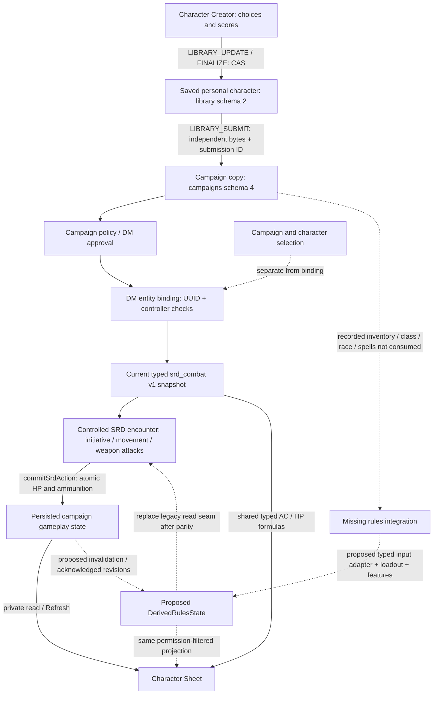

# Checkpoint I — Gameplay architecture audit

## 1. Scope, evidence and executive findings

Audit baseline: `shayanzas/Cubetable`, `dev/ui-hub-library-checkpoint-h`, **`60bd800d89005c1af15db8a3925e2158e4644485`**. `git fetch origin dev/ui-hub-library-checkpoint-h` and `git rev-parse HEAD FETCH_HEAD` agreed before creating `dev/gameplay-architecture-checkpoint-i`. G and H are user-approved. This checkpoint changes documentation only. Nothing below is a newly implemented gameplay feature or migration.

**The existing persistence, permissions and controlled SRD encounter foundations are reusable. A mechanically complete creator-to-combat character does not yet exist.**

1. Personal creation, completion, independent submission, campaign approval, controller assignment and entity binding are real server-backed operations. Selection and binding are distinct. Completion validates the supported creator fields, not all 2014 character-building rules [E1–E6].
2. SRD combat reads `collections.srd_combat[0]`, not the inventory's equipped flags, class name, racial description, feature list or spellbook. The typed inputs already drive weapon attacks, initiative, walking movement, AC, defenses, HP and virtual ammunition [E7–E10].
3. Several apparent duplicates are intentionally separate today: Tactical `Character.stats`, SRD typed data, recorded progression, manual counters, independent campaign copies and immutable encounter snapshots. They must not be indiscriminately merged. **Accidental disagreement within the same SRD character** is the integration problem [E2, E4, E7, E11].
4. Weapon actions atomically save attacker ammunition and defender HP in one campaign-file replacement. Failed writes retain rolls and reserve the action in a paused encounter. This is not a durable cross-restart action journal, nor a generic feature/spell transaction engine [E9, E10, E17].
5. Inventory has stable per-record IDs and compatible-stack merging, but equip is a Boolean toggle of an entire row. There is no authoritative hand/armor loadout, instance split, item-based ammunition debit or don/doff action [E11, E12].
6. Guided class skills, saves and expertise are validated/combined for presentation. Race grants, class armor/weapon proficiency, HP initialization, progression entitlements and all class features remain disconnected from combat. In particular, point-buy scores are currently consumed directly as combat scores without racial ASIs [E1, E7, E13].
7. The verified standard spell catalog contains **zero spells**. Custom definitions, selections and slot trackers are informational/manual. Rest approval does not recover resources. There is no SRD concentration, generic save/check action, bonus-action/reaction scheduler or executable spell pathway [E9, E11, E14].
8. Recommend extending existing sectioned storage with a typed aggregate/read projection, explicit input provenance, loadout transactions and small typed effect handlers. Do not create a second campaign-character repository or let the sheet calculate a separate authoritative character.

### Evidence terminology

- **Implemented and integrated (II):** a real producer, validated persistence path and relevant consumer were traced. Scope restrictions still apply.
- **Implemented but disconnected (ID):** working stored/derived data whose intended downstream consumer is absent.
- **Informational only (INFO):** deliberately manual/reference/display data, not executable rules.
- **Missing (M):** no implementing path found in the audited source and callers.
- **Uncertain pending validation (U):** not established by source inspection or the tests run.

“Verified” below means source-traced behavior, supplemented by the existing baseline tests. The existence of separately editable values is verified; an actual disagreement in the user's saved characters is **U** because no user saved-world records were examined. The risk of double-applied grants or stale previews after a future integration is a **supported inference** from the traced write/read/revision boundaries, not an observed new gameplay defect. “Proposed” means future design. The class/race rule tables are planning summaries of 2014 SRD rules, not an imported executable catalog. Exact external text verification is limited as recorded in section 12.

### Reproducible source index

Paths are relative to the repository. Line anchors refer to the unchanged H baseline; method names are the durable identifiers.

| Ref | Exact source and inspected identifiers |
| --- | --- |
| E1 | [LibraryRepository.java](../src/main/java/dev/tacticalcombat/character/LibraryRepository.java#L14): `Draft`, `update`, `classChangeAllowed`, `validate`, `finalizeDraft`, `decode` (lines 16, 38–99). |
| E2 | [CharacterRepository.java](../src/main/java/dev/tacticalcombat/character/CharacterRepository.java#L18): `Character`, `State`, `submit`, `effectiveSheet`, `srdSnapshot`, `edit`, `track`, `approve`, `bind`, `commitSrdHealth`, `commitSrdAction`, `commit`, `decode`. |
| E3 | [UiApiService.java](../src/main/java/dev/tacticalcombat/uiapi/UiApiService.java#L33): `LIBRARY_CREATE`, `LIBRARY_SUBMIT` (58–74), `CHARACTER_EDIT` (92–95), `character` (131), `libraryDetails` (132). |
| E4 | [CharacterSyncService.java](../src/main/java/dev/tacticalcombat/character/CharacterSyncService.java#L95): `snapshot`; parses SRD data separately from generic `stats`. |
| E5 | [CharacterService.java](../src/main/java/dev/tacticalcombat/character/CharacterService.java#L42): `select`, `remember`, `context`, `srdStats`, `bind`, `release`, `apply`, `capture`; [SelectionStore.java](../src/main/java/dev/tacticalcombat/character/SelectionStore.java#L18): `eligible`. |
| E6 | [UiNetworking.java](../src/main/java/dev/tacticalcombat/uiapi/UiNetworking.java#L34): `handle`, `world`, `CHARACTER_SELECT`, `BIND`, `UNBIND` (107–119); [ApprovalPolicy.java](../src/main/java/dev/tacticalcombat/character/ApprovalPolicy.java): `secureDefault`, `permits`. |
| E7 | [SrdCharacterCodec.java](../src/main/java/dev/tacticalcombat/rules/srd/SrdCharacterCodec.java#L12): `VERSION`, `FIELDS`, `RESOURCES`, `parseSheet`; [SrdCharacter.java](../src/main/java/dev/tacticalcombat/rules/srd/SrdCharacter.java#L7): typed inputs, `armorClass`, `armorDisadvantage`, `walkingSpeedFeet`. |
| E8 | [SrdEquipment.java](../src/main/java/dev/tacticalcombat/rules/srd/SrdEquipment.java#L11): `Armor`, `Weapon`; [SrdRules.java](../src/main/java/dev/tacticalcombat/rules/srd/SrdRules.java#L29): `proficiency`, `initiative`, `plan`, `attack`, `defend`; [SrdHealth.java](../src/main/java/dev/tacticalcombat/rules/srd/SrdHealth.java): `damage`, `heal`, `temporary`. |
| E9 | [SrdEncounter.java](../src/main/java/dev/tacticalcombat/combat/SrdEncounter.java#L60): `start`, `fresh`, `beginTurn`, `preview`, `confirm`, `persistTransaction`, `retry`, `tick`, `snapshot`; [SrdCommands.java](../src/main/java/dev/tacticalcombat/combat/SrdCommands.java): controlled encounter entry. |
| E10 | [SrdNetworking.java](../src/main/java/dev/tacticalcombat/combat/SrdNetworking.java): `handle`, `synchronize`; [TurnRequests.java](../src/main/java/dev/tacticalcombat/core/TurnRequests.java): bounded encounter/turn deduplication; [SrdMovementTurn.java](../src/main/java/dev/tacticalcombat/combat/SrdMovementTurn.java#L52): constructor, `reconcileResources`, `invalid`, `request`. |
| E11 | [SheetSections.java](../src/main/java/dev/tacticalcombat/uiapi/SheetSections.java#L15): `Identity`, `Proficiencies`, `Progression`, `Item`, `Spellbook`, `Features`, `Trackers`, `raw`, `read`, `inert`; [DashboardModel.java](../src/main/java/dev/tacticalcombat/client/ui/DashboardModel.java): `combat`, `xp`, `checks`. |
| E12 | [InventoryModel.java](../src/main/java/dev/tacticalcombat/client/ui/InventoryModel.java#L13): `category`, `quantity`, `equipped`, `catalogAddition`; [InventoryForms.java](../src/main/java/dev/tacticalcombat/client/ui/InventoryForms.java): `item`, `catalog`; [CatalogAddScreen.java](../src/main/java/dev/tacticalcombat/client/ui/CatalogAddScreen.java): `add`; [WizardRecordsScreen.java](../src/main/java/dev/tacticalcombat/client/ui/WizardRecordsScreen.java): `equipmentPicker`, `item`. |
| E13 | [CreationRules.java](../src/main/java/dev/tacticalcombat/uiapi/CreationRules.java): `effective`, `choiceErrors`, `scores`, `transition`; [GuidedRaceRules.java](../src/main/java/dev/tacticalcombat/uiapi/GuidedRaceRules.java): subrace policy; [CharacterWizardScreen.java](../src/main/java/dev/tacticalcombat/client/ui/CharacterWizardScreen.java#L62): `saveCurrent`, `finish`; [GuidedClassChange.java](../src/main/java/dev/tacticalcombat/uiapi/GuidedClassChange.java): existing G atomic reset. |
| E14 | [RpgRecords.java](../src/main/java/dev/tacticalcombat/uiapi/RpgRecords.java): `apply`, `catalog`; [UiWorkflowStore.java](../src/main/java/dev/tacticalcombat/character/UiWorkflowStore.java): `RestState`, `review`; [SpellReference.java](../src/main/java/dev/tacticalcombat/client/ui/SpellReference.java): custom spell inspection. |
| E15 | [Srd2014Catalog.java](../src/main/java/dev/tacticalcombat/client/ui/Srd2014Catalog.java): choices and subclass levels; [FeatureReference.java](../src/main/java/dev/tacticalcombat/client/ui/FeatureReference.java): read-only loader; [feature-reference-v1.json](../src/main/resources/assets/tacticalcombat/ui/feature-reference-v1.json): `classes`, `races`; [SRD-5.1-NOTICE.txt](../src/main/resources/SRD-5.1-NOTICE.txt). |
| E16 | [CharacterDashboardScreen.java](../src/main/java/dev/tacticalcombat/client/ui/CharacterDashboardScreen.java): `refresh`, `display`; [DashboardSource.java](../src/main/java/dev/tacticalcombat/client/ui/DashboardSource.java): scoped section/manual operation envelopes; [UiEvents.java](../src/main/java/dev/tacticalcombat/uiapi/UiEvents.java): permission-filtered transient event stream. |
| E17 | [AtomicJsonFile.java](../src/main/java/dev/tacticalcombat/character/AtomicJsonFile.java#L18): `read`, `write`, `replace`; [SrdResourceFaultTests.java](../src/test/java/dev/tacticalcombat/character/SrdResourceFaultTests.java); [SrdLiveGameTests.java](../src/gametest/java/dev/tacticalcombat/combat/SrdLiveGameTests.java); [SrdRangedGameTests.java](../src/gametest/java/dev/tacticalcombat/combat/SrdRangedGameTests.java). |
| E18 | [CombatInteractions.java](../src/main/java/dev/tacticalcombat/combat/CombatInteractions.java#L28): `equipmentAllowed`; [InventoryAuthorityMixin.java](../src/main/java/dev/tacticalcombat/mixin/InventoryAuthorityMixin.java): physical inventory gates; [CombatManager.java](../src/main/java/dev/tacticalcombat/combat/CombatManager.java): encounter ownership/`blocksVanilla`; [SrdRulesProfile.java](../src/main/java/dev/tacticalcombat/rules/srd/SrdRulesProfile.java): `worldCombat`; [SrdTargeting.java](../src/main/java/dev/tacticalcombat/combat/SrdTargeting.java): `inspect`. |
| E19 | [DiceService.java](../src/main/java/dev/tacticalcombat/dice/DiceService.java): manual server RNG, caller-supplied bounded modifier; [CharacterEdits.java](../src/main/java/dev/tacticalcombat/character/CharacterEdits.java): field diff/apply. |

## 2. Component architecture and end-to-end lifecycle

The server owns `LibraryRepository` and `CharacterRepository`. `UiApiService` provides explicit operations; `UiNetworking` authenticates the player and requires the server thread. `CharacterService` bridges repositories to entities and campaign selection. `CharacterSyncService` provides private character snapshots. `SrdEncounter` owns controlled turn state and consumes approved bound `SrdSnapshot`s. UI classes stage intents and display acknowledgements; their helper calculations are not trusted mutations.



### Actual lifecycle

1. `LIBRARY_CREATE` creates an owner-private draft. Guided SRD defaults use six point-buy scores of 8, while `SrdAuthoring.template` supplies level 1, HP 10/10, speed 30, Medium, armor None and empty weapon/proficiency/defense sets. These are initial inputs, **not class/race-derived defaults**. Capacity is 32 drafts per owner, 1,024 total [E1, E3, E7].
2. Creator saves name, identity, class and ability allocation through revision-checked operations. Class skills/expertise are separate `ui_creation` choices. `abilityAllocation` updates scores and method together. G's confirmed reset is available only to eligible unfinished guided drafts [E1, E13].
3. Finish requires supported validation and exact-revision confirmation of unused point-buy points. `COMPLETE` sets persistent `creationClosed=true`. Editing returns to Draft and preserves that flag; it does not restore destructive creation resets. Duplication creates a separate new draft. “Complete” does not establish legal equipment, HP by Hit Die, racial bonuses or all level entitlements [E1].
4. Submit checks the owner's source revision, completion and campaign membership. It copies the sheet with `ui_origin` (library ID, source revision, submission UUID). Same submission identity/source is recognized in stored campaign records. New copies inherit approval policy, not private-source approval or ownership privileges. Normal default policy requires DM approval; a configured policy can waive new approval. Later library edits/deletes do not rewrite copies [E2, E3].
5. Approval is a revision-checked manager operation. `approve` itself does not prove all SRD rules or even parse the full SRD combat codec; SRD snapshot/admission performs further validation. Future “mechanically ready” must be a distinct validated status [E2, E4].
6. Character selection checks current campaign, role/controller and active encounter lock; it explicitly returns `bindingChanged=false`. `SelectionStore` restores only still-eligible choices. Selection is a convenience context, never an entity-stat assignment [E5, E6].
7. Binding requires approval, current owner/controller membership, manager permission, one character per entity and no duplicate binding; binding to a player requires that player's controller identity. Service gates prohibit changing a target's binding during combat. SRD bindings permit players/mobs at the UI gateway. NPC play is manager-controlled in the controlled encounter [E2, E5, E6, E9].
8. Controlled SRD start requires 2–16 explicit loaded actors, compatible campaign, approved bound SRD inputs, nonzero D&D HP, supported footprints/movement and updated connected clients. It rolls initiative server-side; ties have explicit player/DM resolution. Global `SrdRulesProfile.worldCombat()` remains false: the explicit command/gateway is real, but normal auto-start general SRD combat is not enabled. Some older comments still say the live gateway is future work; the actual `SrdCommands → start/begin` and network callers supersede those comments [E9, E10, E18].
9. Accepted weapon actions persist SRD HP/temp HP and relevant virtual stock; movement/turn/initiative/action-used/intent state remain encounter-local. Zero D&D HP pauses for DM healing/end, not vanilla death or automatic death saves. The world may save entities/positions independently; there is no atomic saved encounter/character/world transaction [E9, E10, E17].
10. Encounter watchers receive filtered revision updates. The dashboard reads a fresh server snapshot on refresh/reopening; it is not subscribed to a unified derived-character change stream. HP in the SRD projection and encounter use the same typed source when read, but an already-open sheet can age [E4, E10, E16].

## 3. Field/source-of-truth matrix

Write policies used below: **L** = owner-only library expected revision, validated section/typed update; **C** = campaign owner or DM, unbound, field policy, expected character revision (runtime revision when replacing HP/SRD inputs); **R** = trusted accepted SRD effect with both full snapshots/CAS and atomic campaign write; **M** = controller/DM manual-counter whitelist and independent manual revision. All campaign reads below remain role-filtered. A library/campaign distinction is intentional, not conflicting copies.

| Value / current storage | Authoritative writer and validation | Current readers / gameplay use | Classification and missing connection |
| --- | --- | --- | --- |
| Six abilities: `srd_combat.abilities` | L `abilityAllocation`/typed combat; C combat section. Codec 1–30; guided point-buy/array constraints [E1,E7,E13] | SRD modifiers, attacks, initiative, armor, heavy-armor speed; sheet/check projection | II for entered scores; M race/class adjustment provenance. |
| Race/subrace: `ui_identity.species` text, `ui_race_policy` | L/C; guided supported-parent/subrace validation; free/custom records preserved | Creator and reference panels; no combat race input | INFO; racial grants, size/speed and ASIs disconnected. |
| Class/subclass: `ui_identity`; progression classes/history | L/C, starting-choice constraints, not full advancement rules | Class references, effective recorded proficiencies | ID; no class entitlement engine, legal subclass progression or HP grant. |
| Level: `srd_combat.level` versus `ui_progression.recordedLevel`, possible generic `values.level`/`stats.level` | L/C independently; each bounded, no equality invariant | SRD proficiency from typed level; XP header and choice eligibility from recorded level | ID conflict. A displayed level change is not combat advancement. |
| XP/mode/pending choices/feats: `ui_progression` | L/C structural validation | XP bar/history; no advancement transaction | INFO. |
| Skills/saves/expertise/tools/languages: `ui_proficiencies` + `ui_creation` | L/C with `CreationRules.transition`; reads merge eligible class grants | `DashboardModel.checks`: ability + recorded proficiency/expertise + recorded adjustments | ID/INFO: computed tabletop totals, no authoritative check/save consumer. |
| Armor/weapon proficiency: typed sets/Boolean in `srd_combat` | L/C codec enums; not generated from class/race | `armorDisadvantage`, weapon attack proficiency | II typed values; M validated class/race grants. Reference prose is not these sets. |
| Max/current/temp HP: `srd_combat.hp_max/hp/temporary_hp` | Max L/C; current/temp also R `commitSrdHealth/Action`; bounds | Encounter damage/healing and server sheet projection | II resource arithmetic; M class/level initialization, rests/death saves. |
| Generic HP/AC/etc.: `Character.stats`, overlaid into `sheet.values` | Submit captures whitelisted generic values; C; Tactical capture increments runtime revision | Tactical profile/vanilla health and manual packs | II Tactical, not SRD authority. Do not migrate by treating generic AC as SRD AC. |
| Armor/shield/AC adjustment: `srd_combat.armor/shield/ac_bonus` | L/C typed input; derived AC bounds | `armorClass()` → encounter target defense + server sheet | II formula for subset; ID from inventory; M alternative class bases and temporary effects. |
| Inventory: `ui_inventory.items`, currency | L/C whole-section CAS; unique namespaced row IDs, quantities 0–10,000, max 64 rows | Inventory UI/catalog; equip flag toggles per row | ID: no server loadout, instance split or combat spend. |
| Item definition/properties/slot/physicalMapping | L/C bounded text/lists, not trusted rules catalog validation | Display, client categorization/merge; mapping is a note | INFO; names can categorize visually but never authorize mechanics. |
| Weapons: `srd_combat.weapons`, `weapon_proficiencies` | L/C enum sets; `plan` checks permission to use chosen weapon | Available attacks and attack modifier | II approved catalog availability; no actual held-instance identity. |
| Arrows/bolts/daggers: `srd_combat` optional counters | L/C; R debits on accepted ranged/thrown actions, including misses | `plan`/target check, encounter stock display | II virtual stock; ID from inventory quantities. Legacy default dagger=1 if available; arrows/bolts=0 [E7]. |
| Initiative bonus, attack bonus, damage bonus | L/C bounded typed overrides | Added by SRD calculations | II manual approved inputs, not calculated class grants. Must retain provenance on conversion. |
| Speed/size/reach: typed SRD fields | L/C bounds/enums; speed reduced for heavy armor Strength deficit | Movement budget, footprint, reach/targeting; sheet | II manual inputs; racial speed/size and class speed missing. |
| Damage resistance/immunity/vulnerability: typed enum sets | L/C; duplicate enum rejection | `defend` aggregates by damage type and applies defenses | II static typed defenses; race/feature/source-tag conditional defenses missing. |
| Features/conditions/duration/use pools: `ui_features` | L/C creation; M whitelisted pool edits; `AUTOMATED` status rejected | Reference/manual display; durations do not tick | INFO; no executable effects from these records. |
| Spell definitions/selections/slots/DC/attack: `ui_spellbook` | L/C; custom-only definitions; selections must resolve to custom definitions; M slot bookkeeping | Custom inspection and manual counters | INFO; legal cast, resource spend, effects/concentration all M. |
| Inspiration/death successes/failures/exhaustion/Hit Dice: `ui_trackers` | L/C or M; only DM can increase campaign Inspiration | Manual records/events; no roll/health/exhaustion rules | INFO; integer Inspiration is a project manual counter, not proof of standard Inspiration mechanics. |
| Approval/controller/binding/selected IDs | Repository/selection service operations with distinct revisions/permissions | Admission, private views, action control | II; no silent automatic binding. |
| Runtime intent/initiative/order/movement/actionUsed | Server encounter, turn identity and snapshot checks | Encounter client and action resolution | II for controlled scope; M durable resume, bonus actions/reactions/general effect clock. |
| Rest request/review: `ui-workflows.json` | Membership, party/world checks and DM review | Requested / approved-for-adjudication / rejected / expired UI | II workflow, INFO recovery; no slots/HP/resource restoration. |

### Three concrete current traces

**Dexterity:** creator score buffer → `LIBRARY_UPDATE abilityAllocation` with saved revision → `srd_combat.abilities.dex` → finalized independent campaign sheet copy → `srdSnapshot` codec → `SrdRules.initiative`, `Armor.ac`, eligible finesse/ranged `plan` → accepted attack/initiative. The sheet reads the same typed score and produces informational saves/skills. It does **not** cause an automatic Dexterity save/check action, nor add Elf/Halfling ASIs. Nonproficient-armor disadvantage is applied to weapon attack plans, but initiative currently rolls Normal; there is no complete STR/DEX check/save penalty path [E7,E8,E11,E13].

**HP:** template starts at 10/10, independent of chosen class/CON. Typed authoring can change approved inputs while unbound. Encounter `confirm` validates preview, reserves action, rolls once, computes `SrdHealth.damage`, then `commitSrdAction` saves target HP/temp HP and attacker stock together. `runtimeRevision` advances; only then are snapshots/results published. The original library and generic Tactical stats are untouched. On future sheet refresh, `CharacterSyncService.snapshot` returns current typed HP. No class HP gain, death saves or rest automation follows from the creator name/features [E1,E2,E4,E7–E10].

**Armor:** catalog/form → item row in `ui_inventory` → server section save → `InventoryModel.equipped` toggles that row's Boolean. This path stops at storage/display. Independently, typed `srd_combat.armor` + DEX + `shield` + `ac_bonus` derive AC for the encounter. Equipping studded leather in inventory does not alter that typed armor. No transaction verifies ownership of a shield, hand use or donning time. This is the central K integration gap [E7,E8,E11,E12].

## 4. Equipment and physical-inventory audit

Existing IDs are namespaced strings such as `custom:<UUID>` and unique within one inventory, not globally across campaign copies. Submission/duplication copies IDs; future references must always be scoped by character. Catalog definitions currently look like `srd:weapon:LONGSWORD` and `srd:armor:PLATE`; these are text values, not validated registry handles. Older wizard-added items may have empty definitions and only a name. `InventoryModel.category` can recognize display names; migration must not turn this convenience into automatic mechanical identification.

`catalogAddition` merges only an unequipped row whose definition/name/slot/properties/notes/physicalMapping match, preserving the chosen existing ID. “Keep as Separate Item” retains the new intent ID. This is client staging with server whole-section validation, not a server inventory transaction. Quantity zero is valid; quantity adjustment clamps locally. Equipped rows can have quantity greater than one, zero, or arbitrary slots. No cross-row hand conflict is validated. The UI guards ambiguous add acknowledgements, but server persistence does not implement general inventory intent receipts [E11,E12].

Physical inventory remains separate cleanly: SRD rules use virtual stock and explicit typed equipment. `physicalMapping` is only text. During SRD encounters `CombatManager.blocksVanilla` makes `CombatInteractions.equipmentAllowed` false, and `InventoryAuthorityMixin` gates Minecraft slot/drop/swap/trade/craft operations. Preserve those guards. They do not provide D&D equipment rules and must not be relaxed merely to enable a D&D equip request [E18].

### Recommended model — proposed, not implemented

Extend the existing character's inventory section, not a parallel inventory service/database:

- Preserve row ID and notes; add server-validated optional definition identity/version, stack kind and explicit instance metadata (e.g. future charges/modifications/attunement). Unrecognized/custom items remain opaque/manual until authorized mapping.
- Ordinary homogeneous stacks may have quantity >1. A loadout reference to armor, shield or held weapon must resolve to an owned **quantity-1 instance**. Ammunition sources may reference a compatible stack.
- Add a versioned loadout record: `armor`, `mainHand`, `offHand`, `shield`, `ammunitionSource`; values reference inventory IDs scoped to this character. `shield` and `offHand` are constrained aliases for the same occupied hand, not two independent free slots. A shield occupies off hand; no different off-hand item may coexist. Store one canonical reference and derive the UI alias.
- A two-handed grip reserves both hands on the same main-hand instance; distinguish **holding** a two-handed weapon in one hand from **using it** with two hands. Store/validate grip intent; attack validation requires two available hands. An occupied shield must first be doffed. Extend the slot vocabulary later with validated definitions; unknown slots grant no effect.
- Deprecate ordinary authoritative use of `equipped`/free-text `slot`; project them for legacy display. Never maintain two independent editable loadouts.
- Equipment definitions hold mechanics; player-editable names/properties text cannot grant damage, AC or magical modifiers. Custom mechanics require explicit DM-approved structured overrides.

**Transactions:** propose `EQUIPMENT_PREVIEW`/`EQUIPMENT_COMMIT` with character scope, item ID, requested slot/grip, operation UUID and expected build/runtime revisions (plus encounter/turn when applicable). Client never submits computed AC, final quantities or action costs. Server rechecks ownership/controller/policy, item definition, current loadout, quantity, approval and encounter phase; prepares one immutable candidate containing split/merge/loadout/action-cost changes; validates derived state; writes once; then publishes. An ordinary player cannot mint stock. Add/remove/transfer is a distinct owner draft or DM-authorized acquisition/disposition operation; transfers between campaign characters use one campaign-store transaction and both revisions, never two independent saves.

**Stack example:** five daggers in row A → equip one: A becomes 4, new instance B=1 goes to main hand, all in one commit. Equip another: A=3, C=1 off hand. Unequip B clears its reference; merge only if its complete mechanical and descriptive metadata match A and neither is referenced by a loadout/pending transaction. A=4, B retired. Throw C consumes/removes exactly C and clears its slot in the same attack transaction that changes target HP; it must not also decrement a legacy `daggers` counter. Recovery later requires an explicit tracked recovery/adjudication operation, not free automatic replenishment. Unique/magical/modified instances never merge merely by name. Tombstones/operation receipts prevent retry resurrection; total quantity conservation is a test invariant.

**Rules boundaries:** proficiency does not prohibit wearing armor; it imposes the actual disadvantage/casting consequences. Insufficient Strength reduces heavy-armor speed, subject to verified racial exceptions; it does not remove armor AC. Shield don/doff takes an action; light armor don/doff 1 minute, medium don 5 minutes/doff 1, heavy don 10/doff 5 (help can reduce doffing time). A weapon draw/stow uses the supported object-interaction allowance or action; changing grip is a separate explicit adjudicated rule, not a universal free equip. K initially rejects timed armor changes during active encounters. A later timed-operation checkpoint can implement them. The UI must explain this restriction. No guessing from Minecraft materials or item names.

## 5. AC and derived statistics

Current armor catalog: None, Leather, Studded Leather, Chain Shirt, Scale Mail, Chain Mail and Plate. Shield is a Boolean, not an item. Missing standard armor entries: Padded, Hide, Breastplate, Half Plate, Ring Mail and Splint. Catalog completeness also requires stealth disadvantage, price/weight, don/doff times and requirements. Weapons are Unarmed plus Dagger, Longsword, Shortsword, Greatsword, Shortbow, Longbow and Light Crossbow; most SRD weapons are absent [E8].

Current AC is `armor.ac(DEX modifier) + (shield ? 2 : 0) + acBonus`. Light/None add full DEX, medium caps only the upper bonus at +2 (negative DEX still applies), heavy ignores DEX. Typed attack proficiency and armor penalties work within this subset. `acBonus` is a manually authored flat input; class features do not generate it.

### Recommended single calculation path

Propose pure server/shared `CharacterRules.derive(approvedInputs, runtime, effectContext, catalogVersion)` returning immutable `DerivedRulesState` with provenance/breakdowns. Reuse `SrdRules` arithmetic and adapt the existing `srdSnapshot` seam. A compatibility adapter must reproduce every legacy v1 result before opt-in conversion. The server sends the result to the sheet; the encounter consumes the same evaluator. Client preview may call the pure evaluator for advisory UX but never establishes authority.

AC calculation stages:

1. Validate loadout and grant/effect eligibility.
2. Build eligible **alternative base formulas**: ordinary unarmored `10+DEX`; worn armor formula; Barbarian `10+DEX+CON` only unarmored (shield allowed); Monk `10+DEX+WIS` only no armor and no shield; future Draconic Resilience/Mage Armor handled as alternatives too.
3. Select an eligible formula by explicit saved choice, or a documented highest-valid-formula default presented to the user. Never add two bases together. Formula choice/default is a product decision for approval.
4. Apply permitted additive modifiers once: shield +2 where compatible, Defense style +1 only while wearing armor, explicitly supported item/effect modifiers. Preserve a distinct manager-authorized override with source/reason, bounds and expiration; do not silently interpret old `ac_bonus` as a class feature.
5. Apply target/context adjustments such as cover at attack resolution, not permanent base AC. Return the breakdown and version stamp. Temporary effect expiry invalidates the projection.

| Required future test | Exact expected case / distinction |
| --- | --- |
| Unarmored, DEX 14 | AC 12. |
| Studded leather, DEX 14 | AC 14; +shield =16; remove shield =14. |
| Heavy armor, STR too low | Chain mail AC16 regardless of DEX; STR12 normally reduces 30-ft base speed to20. Verified dwarf exception removes that penalty. |
| Armor without proficiency | AC still applies; disadvantage on applicable STR/DEX ability checks/saves and attacks; cannot cast spells. Current weapon-only disadvantage is incomplete. |
| Barbarian, DEX14 CON16 | Unarmored AC15; with shield17. Equip leather: ordinary leather13 (+shield15), not 18/20. Can choose an eligible ordinary unarmored base instead if preferable. |
| Monk, DEX14 WIS16 | No armor/shield AC15. Shield makes Monk formula ineligible: ordinary unarmored12 +shield2 =14, with shield nonproficiency consequences unless another grant supplies it. |
| Two-handed weapon | Requires two usable hands at attack time; shield conflict rejected. No inherent AC bonus/penalty from holding the weapon alone. |
| Defense style | Studded leather DEX14 shield + style =17; unarmored receives no Defense bonus. |
| Temporary AC modifier | Explicit eligible +2 on AC14 gives16; expiry returns14 exactly once, including reconnect/reload policy. No double stacking of same effect. |

Other derivations: initiative currently DEX+typed bonus; walking speed typed minus armor Strength penalty; HP/max/temp are inputs/resources, not class grants; proficiency is `2+(level-1)/4`; attack is legal ability + weapon proficiency + typed bonus; damage is weapon dice + ability + typed bonus, critical doubles dice. Saves/skills are sheet-only recorded totals. Spell DC/attack are manually recorded numbers, not derived casting statistics. Future evaluator must derive skill/save proficiency, expertise once, HP maxima from retained advancement choices, caster DC `8+PB+ability`, spell attack `PB+ability`, speed/size from validated grants, and condition-specific advantage/disadvantage. Current `SrdRules.defend` handles static type defenses; extend with source/context (magical, weapon, spell, conditional) rather than adding permanent Rage resistance to the saved race data [E7,E8,E11].

## 6. Class/race/proficiency integration and levels 1–3

Verified common status for **all twelve classes**: choice labels, level-1 skill pools/save grants and read-only feature references exist [E13,E15]. Rogue/Bard expertise limits use recorded level. These effective grants appear in the sheet, not `SrdCharacter` save/skill/armor/weapon grants. Recorded class names do not initialize Hit Dice, max HP, equipment, resources or spellcasting. Reference entries include level metadata but do not grant executable abilities. There is no full subclass-selection entitlement transaction. The following is the target content matrix, not a claim that the listed mechanics run today.

| Class / Hit Die | Level 1 target | Level 2 target | Level 3 target and authorized SRD subclass | Resource/casting dependencies; current mechanical status |
| --- | --- | --- | --- | --- |
| Barbarian d12 | Rage; Unarmored Defense | Reckless Attack; Danger Sense | Path at **3**, Berserker: Frenzy | Rage 2/2/3 uses by levels1/2/3, +2 damage, long-rest recovery. Bonus action, durations, damage contexts, saves, exhaustion. Features INFO; executable mechanics M. |
| Bard d8 | Spellcasting; Bardic Inspiration d6 | Jack of All Trades; Song of Rest d6 | College at **3**, Lore: bonus skill proficiencies and Cutting Words; Expertise | Inspiration CHA modifier minimum1 uses, long rest at these levels. Full CHA caster; reaction, check modifiers, rest healing. Only recorded skill/expertise grants ID; casting/features M. |
| Cleric d8 | WIS prepared Spellcasting; Domain at **1**, Life: heavy armor proficiency, Disciple of Life, domain spells | Channel Divinity (1/rest): Turn Undead and Life Preserve Life | 2nd-level spells; Life domain spells | Healing-source rules, turn/fear/condition targets, rest recovery, always-prepared spells. Domain label/reference INFO; effects/casting M. |
| Druid d8 | Druidic; WIS prepared Spellcasting | Wild Shape (2/short or long rest, initial restrictions); Circle at **2**, Land: bonus cantrip, Natural Recovery | 2nd-level spells; terrain-dependent Circle spells | Transformation/temporary form HP and retained traits, constrained beast catalog, spell preparation. Wild Shape/effects M; do not pretend a UI form toggle suffices. |
| Fighter d10 | Fighting Style; Second Wind (1d10+Fighter level) | Action Surge (one additional action, 1/rest) | Archetype at **3**, Champion: Improved Critical (19–20 weapon attacks) | Second Wind bonus action 1/short or long rest; extra-action budget, style predicates. Weapon base engine II; style/class actions M. |
| Monk d8 | Unarmored Defense; Martial Arts d4 | Ki (2 points); Flurry of Blows, Patient Defense, Step of the Wind; Unarmored Movement +10 ft | Tradition at **3**, Open Hand Technique; Deflect Missiles; Ki3 | Ki short/long rest with meditation; bonus actions/reaction, monk-weapon/armor constraints, saves, movement modes. All class mechanics M. |
| Paladin d10 | Divine Sense (1+CHA uses/long rest); Lay on Hands (5×Paladin level pool) | Fighting Style; CHA prepared Spellcasting; Divine Smite | Oath at **3**, Devotion: oath spells, Sacred Weapon/Turn the Unholy Channel Divinity; Divine Health | Pool healing, attack-hit decision/resource spend, radiant damage components, disease immunity. Half-caster starts2; executable features M. |
| Ranger d10 | Favored Enemy; Natural Explorer | Fighting Style; WIS known Spellcasting | Archetype at **3**, Hunter: choose Colossus Slayer/Giant Killer/Horde Breaker; Primeval Awareness | Known spells, slots, once-per-turn attack predicates and reaction; exploration hooks. Half-caster starts2. Features INFO/M. |
| Rogue d8 | Expertise; Sneak Attack1d6; Thieves' Cant | Cunning Action | Archetype at **3**, Thief: Fast Hands, Second-Story Work; Sneak Attack2d6 | Bonus-action choices, ally/advantage and finesse/ranged predicates, once-per-turn (not merely once on own turn) damage; no SRD Thief casting. Recorded expertise ID; mechanics M. |
| Sorcerer d6 | CHA known Spellcasting; Origin at **1**, Draconic Bloodline: Dragon Ancestor, Draconic Resilience (AC alternative/HP) | Font of Magic: sorcery points2, Flexible Casting | Metamagic choices2; sorcery points3 | Point/slot conversion atomicity; spell-specific cost/target modification. Spell/feature execution M. |
| Warlock d8 | Patron at **1**, Fiend: Dark One's Blessing; CHA Pact Magic | Eldritch Invocations (2) | Pact Boon (Blade/Chain/Tome); slots become level2 | Pact slots:1 atL1,2 atL2/3; short/long-rest recovery, separate from normal slots. Patron expanded list adds options, not automatically known spells. Invocation prerequisites/familiar/weapon dependencies. M. |
| Wizard d6 | INT spellbook/prepared Spellcasting; Arcane Recovery | Tradition at **2**, Evocation: Evocation Savant, Sculpt Spells | 2nd-level spells and spellbook additions | Spellbook acquisition/copying, preparation, ritual rules, once/day recovery, area target exceptions. All executable mechanics M. |

This table expands the existing reference summaries; the JSON is not complete executable content. For example, it names Lore/Life/Land/Thief/Draconic/Evocation but should not be mistaken for implementation of every subordinate feature. Only the listed SRD subclass per class is assumed. No Battle Master, Arcane Trickster, alternative published domains/origins or other non-SRD subclasses are authorized by a generic class name.

### Casting progression needed by level 3

Bard/Cleric/Druid/Sorcerer/Wizard use standard full-caster slots: level1 **2 first**, level2 **3 first**, level3 **4 first +2 second**. Paladin/Ranger begin at2: **2 first**, then **3 first** at3. Warlock uses its separate Pact Magic schedule above. Bard/Sorcerer/Ranger/Warlock known-spell counts, Cleric/Druid/Paladin preparation, Wizard book versus preparation, class cantrip counts and source-specific bonuses must be validated separately; a single “known/prepared” Boolean is not a complete entitlement model. No spellcasting for SRD Barbarian/Fighter/Monk/Rogue levels1–3.

### Barbarian first vertical slice

Reuse existing weapon action and defense arithmetic; add only the missing typed hooks:

- Grant Rage pool from Barbarian level; spend one use plus a bonus action atomically on activation. Duration one minute/10 rounds, explicit voluntary bonus-action termination, unconsciousness termination and end-of-turn early termination if neither attacked a hostile creature since the last turn nor taken damage since then. Track a real hostile relation: current free-for-all is insufficient for party play. Start/end timing needs an unambiguous expiry convention.
- Rage benefits require not wearing heavy armor: advantage on Strength checks/saves, +2 at levels1–3 to melee weapon attacks using Strength, and bludgeoning/piercing/slashing resistance. No Rage damage for DEX attacks or thrown attacks merely because the weapon is a dagger. Resistance is not limited to nonmagical damage. Raging prevents spellcasting/concentration when applicable; activation legality and benefit eligibility are separate.
- Unarmored Defense is an alternative base, shield allowed, inactive while armored. It must not write a permanent AC bonus.
- Reckless Attack choice occurs on the first attack on the Barbarian's turn: advantage on Strength melee weapon attacks that turn, attacks against the Barbarian gain advantage until their next turn. Not all attacks/checks; preserve advantage/disadvantage cancellation.
- Danger Sense grants advantage on DEX saves against effects the character can see, unless blinded, deafened or incapacitated. Requires an actual saving-throw and visibility/condition context; it is not a blanket DEX bonus.
- Berserker Frenzy at3 adds a single melee weapon attack as a bonus action on turns after the activation turn while the chosen Frenzy lasts, and grants one exhaustion level when Rage ends. Must introduce verified exhaustion consequences and durable once-only termination handling; an inert exhaustion counter is insufficient. If these prerequisites are not ready, ship earlier Barbarian levels as a clearly bounded slice and do not call level3 complete.
- Rage recovery belongs to a validated completed long rest, not `REST_REVIEW APPROVED_FOR_ADJUDICATION`. Stop/restart policy must preserve resource spend and correctly settle active Frenzy consequences; no free Rage/refund through reconnect.

### Racial mechanics

All traits below are current **INFO**, with guided identity/subrace validation **II** and mechanical grants **M**. Typed combat values may be manually set to match them, but the code does not infer a causal grant. Existing reference JSON contains these race families/subraces [E13,E15].

| Authorized race | Proposed base + subrace inputs | Mechanics/dependencies to integrate later |
| --- | --- | --- |
| Human | +1 all six; Medium;30ft | Languages; no automatic variant-human feat (not the SRD baseline). |
| Elf / High Elf | DEX+2, High Elf INT+1; Medium;30ft | Darkvision, Perception, Fey Ancestry, Trance; elf weapon training; wizard cantrip INT; language choice. |
| Dwarf / Hill Dwarf | CON+2, Hill WIS+1; Medium;25ft | Heavy-armor speed exception; darkvision; poison resistance and poison-save advantage; weapon/tool grants; stonecunning; +1 HP per level. |
| Halfling / Lightfoot | DEX+2, Lightfoot CHA+1; Small;25ft | Lucky reroll policy, Brave frightened-save advantage, Nimbleness, Naturally Stealthy visibility/cover rules. |
| Dragonborn | STR+2 CHA+1; Medium;30ft | Ancestry-selected damage resistance and breath shape/type/save; breath action and short/long-rest use. |
| Gnome / Rock Gnome | INT+2, Rock CON+1; Small;25ft | Darkvision; advantage INT/WIS/CHA saves against magic; Artificer's Lore, Tinker/tool records. |
| Half-Elf | CHA+2 and two different other abilities+1; Medium;30ft | Darkvision, Fey Ancestry, two skill choices/languages. |
| Half-Orc | STR+2 CON+1; Medium;30ft | Darkvision, Intimidation, Relentless Endurance1/long rest with instant-death exception, Savage Attacks additional melee weapon critical die. |
| Tiefling | CHA+2 INT+1; Medium;30ft | Darkvision, fire resistance, Thaumaturgy; at3 Hellish Rebuke as second-level racial cast once/long rest (CHA), with reaction infrastructure. Darkness is beyond initial level3. |

Never automatically add ASIs to historical numbers: a manual author may already have included them, while current guided point buy stores base values directly. Add explicit `baseScores` plus provenance-qualified adjustments only after review/migration. Keep unsupported custom race names and historical grants as manual data, not official mechanics. Darkvision must not simply read Minecraft night vision; `SrdTargeting` currently handles sampled cover/invisibility, not a complete light/vision rules engine. Additional guided tools/languages are presently restricted by `CreationRules.transition`; new race grants need a validated server entitlement operation, not bypassing that restriction through raw text.

## 7. Spellcasting, feats and advancement

### Verified spell/feat baseline

`RpgRecords.catalog` returns total0 and explains that standard definitions have not been imported/verified. `SheetSections.SpellDefinition` accepts only `custom:` definitions with `custom=true`; every `SpellSelection` must resolve to one of those custom definitions. Fields describe range/components/concentration/duration, but none execute. Slots and recorded save DC/attack modifiers are manual. `RpgRecords.apply SPELL_SLOT` is a bookkeeping assignment, not a cast. `SrdNetworking.handle` has no cast operation [E11,E14]. Manual `DiceService` does roll on the server, but its modifier/label come from the request and it does not validate character checks or apply spells; it cannot serve as a trusted spell-save pathway [E19].

`Srd2014Catalog.FEATS` contains Grappler reference only. `ui_progression.feats` and `FeatureKind.FEAT` preserve manual entries. Normal single-class ASI/feat substitution begins at level4 for these classes, beyond this target. No standard SRD level1–3 feat selection is needed. Build namespaced grant IDs/prerequisite checks shared with class/effects early; defer catalog/UI and Grappler automation until grapple/restrained/opposed-check mechanics exist. Preserve custom/DM grants without mechanically promoting them.

### Recommended spell foundation

Separate four questions in both model and UI: **listed** (manual/reference), **entitled** (class/race/book/known/prepared), **castable now** (resources/components/action/context), **active effect** (committed duration/concentration). A known spell must not automatically become prepared, and an always-prepared domain spell must not consume preparation capacity. Separate spellbook acquisition from known/prepared selections.

Proposed `SpellDefinition` server catalog records source edition/version/attribution, stable ID, level/school, legal class-list membership, casting time, range/target rules, components, costly/consumed materials, concentration, duration, save/attack resolution and handler identity. Keep executable handlers as reviewed Java behaviors with typed parameters, not formulas/scripts from a custom description. Data content and executable support have separate capability flags. Importing a description does not enable Cast.

Proposed initial subset for source verification: **Fire Bolt** (ranged spell attack), **Sacred Flame** (DEX save, its cover exception), **Cure Wounds** (touch healing, valid creature exclusions), **Bless** (slot, multiple selected creatures, concentration/duration and attack/save die modifier). These are proposed SRD spells; source-text import/validation is a prerequisite, not completed here. Exclude full utility/area/reaction repertoire initially. Follow with a reaction slice for Shield and racial Hellish Rebuke; reaction timing cannot be faked with a free out-of-turn button. This foundation must precede completion of the other caster classes.

Casting intent: validate controller/approval, spell entitlement and class source, slot or other cost, component/free-hand/focus rules, range/target/LOS, current phase and concentration replacement choice → server previews → revalidate and roll once → atomic slot/resource/HP/effect/concentration commit → filtered result. Concentration damage save uses CON, DC max(10, half damage), correct damage-instance semantics and damage actually taken after defenses; temporary HP absorption still counts as taking damage. Incapacitation/death ends concentration. Multiple damage sources may require multiple checks. No rerolls on storage retry. Replacing concentration must remove its linked effects in the same transaction. One active concentration per caster, never a Boolean on each independent target without source identity.

Class-specific resource adapters: standard slots, Warlock pact slots, Sorcery Points, racial limited casts, Wizard Arcane Recovery/Druid Natural Recovery, ritual eligibility and learned/prepared provenance. No generic manual-slot endpoint may modify automated pools. Short/long-rest completion must validate duration, interruptions and eligibility, then apply class-specific recovery once; a DM approving a request is not proof that time elapsed.

### Proposed progression transaction

1. Owner proposes advancement, DM authorizes according to campaign policy; validate XP threshold/milestone and supported class level. Approval of the request and application are distinct.
2. Stage the target single-class level and required choices; do not publish a half-leveled character. Subclass gates are class-specific (table above).
3. Recompute grant IDs/resources/proficiencies/spell eligibility from level; retain source-qualified historical/custom grants separately and flag conflicts.
4. Record HP gain decision (fixed average or approved/server roll) once, including CON/racial contributions; no reroll on retry. Recompute maximum HP; define current-HP increase policy explicitly and test it. Standard max-HP increase is not an automatic full heal.
5. Validate all choices together; persist inputs/resources/approval transition/receipt in one candidate revision. Reapproval policy must be visible. Initially require out-of-encounter advancement; do not rebase a live preview onto new stats.
6. Return shared derived state, invalidate sheet cache and next-encounter snapshot. Keep future class-level entries extensible for multiclassing, but reject multiclass activation until separately approved/implemented. No early multiclass engine is required.

## 8. Server authority, concurrency and failure analysis

| Guarantee | Existing enforcement and limit | Required extension |
| --- | --- | --- |
| Authenticated ownership/DM control | Network uses `CharacterService.principal`, server thread; repository membership/owner/manager checks; encounter `controls` checks bound player/controller or DM [E2,E6,E9,E10] | Typed equipment/spell/progression verbs must reuse checks; no client permission flags. Controllers can play but do not gain owner build-edit rights. |
| Stale writes cannot overwrite | Library revision; character build revision; runtime revision for SRD replacement; independent manual revision; encounter compares full expected snapshots | Define revision domains for new inputs/resources/effects. Every value used in a preview must be in its expected stamp or explicitly revalidated. |
| Rejected actions spend no resource | Preview/confirm validation precedes accepted roll/spend. Network request ID may be consumed to prevent expensive retries without gameplay spend | Keep rejected identity consumption distinct from gameplay cost; deterministic plan validation must precede RNG and reservation. |
| Save failure does not publish partial HP/stock | `commitSrdAction` constructs both new records and one `State`; `commit` writes before assigning state. Fault tests assert unchanged bytes/resources | Expand same boundary for item instances, pools, effects, concentration and action receipts. Never split inventory and target HP into separate files/commits. |
| Retry cannot double-apply | `TurnRequests`, intent ownership/turn, `actionUsed`, retained `Transaction`, full-snapshot CAS; successful actions advance both runtime revisions even on no HP change | Existing receipts are not persisted; implement durable operation identity/results and prepared outcomes before cross-session retries. Never retry by reading a new revision and rerolling. |
| Failed action retains dice | Encounter pauses, `SAVE_FAILED`, DM retry uses stored `roll/health`; conflict does not rebase [E9,E17] | Prepared transaction outcome should survive restart, or restart must explicitly invalidate the encounter and require adjudication without replay. Recommend durable prepared outcome for new effects. |
| Binding changes respect combat | Service bind/unbind/release checks `CombatManager`, while repo handles identity/permission | Repository is a trusted storage layer, not a world-lock oracle. New routes must always use appropriate service gate. |
| Private data remains private | `visible`, summary filters, encounter controls-only HP/stock, per-viewer snapshots; events permission-filtered | Do not broadcast new full derived records; split public/private/DM fields and invalidate viewers after role changes. Current controlled encounter intentionally exposes actor positions and treats all participants as hostile. |
| Personal edits do not rewrite campaign | Submission copies sheet and records origin; no write-back relationship | Preserve separate scope on item/effect/resource IDs; never “sync latest library” silently into approved play. |
| Safe derived cache | `parsedSrd` uses immutable Character object identity and invalidates changed entries; authorization rechecked | New cache key must include build/runtime/effect/catalog/rules-version context, never cached authorization. Invalidate only after successful commit. |

### Limits that matter for integration

- `SrdSnapshot` contains character/actor/campaign/build revision/runtime revision/typed stats. Manual tracking can replace sheet bytes and advance **manual** revision without changing this snapshot because its values are intentionally inert. If a new mechanic starts consuming a formerly manual field without changing the stamp, stale-intent protection breaks. Promote through an explicit typed versioned path, not a new hidden read from `ui_*` [E2].
- `SrdMovementTurn` caches the turn budget and terrain inputs. `reconcileResources` accepts a new snapshot only with unchanged build revision, speed and size. Mid-turn equipment/class effects that change speed/size need a designed reconciliation policy preserving spent feet and invalidating routes; simply refreshing snapshots will throw or reset movement incorrectly [E10].
- `persistTransaction` writes first, then reconciles movement/publishes. Current resource changes preserve movement invariants. Broader future effects must prevalidate all post-commit application steps and recover by rebuilding committed projection, never treat a post-commit presentation failure as permission to spend again.
- `AtomicJsonFile` validates, writes/fsyncs a same-directory temp file and atomically replaces the target. It retains a validated backup; unsupported future primary versions fail rather than silently rolling back. It does not implement a multi-file transaction or explicit parent-directory fsync. Tested pre-replacement failures are not proof against every power-loss/filesystem failure. Backup recovery can deliberately restore an older committed state; it is not globally exactly-once history [E17].
- Runtime encounter state, action receipts, event stream and pending rolls are in memory. Ending/restarting does not resume an encounter; resource bytes survive if committed. Plan explicit restart handling before adding durable Rage/Frenzy/concentration.
- The generic Tactical `Combatant` has action/bonus-action fields, but the SRD encounter uses its own `actionUsed` and no reaction/bonus-action implementation. Do not silently reuse Tactical actions with different semantics.

## 9. Recommended source-of-truth architecture and alternatives

Keep existing repositories and sectioned serialization, but create a **typed character aggregate** at their read/write boundary. This satisfies one authoritative state per character without flattening all manual packs into a monolithic new schema.

| Decision | Alternatives considered | Recommendation and justification |
| --- | --- | --- |
| Character model | Replace all sheets with new repository; continue independent ad-hoc projections; typed aggregate over current records | Typed aggregate/adapters. Preserves IDs, provenance, UI and permissions while giving combat one validated input contract. |
| Calculated values | Persist AC/PB/check totals everywhere; compute separately in UI/engine; shared pure evaluator | Persist inputs, derive outputs once through shared evaluator; server read model is authoritative. Legacy overrides remain typed inputs. |
| Inventory loadout | Boolean per stack; duplicate equipment records; references to existing instances | Scoped inventory IDs + slot/grip references, split quantity1 instances atomically. Reuse existing identity/metadata. |
| Effects/features | Execute text/formulas; giant generic scripting framework; typed feature handlers | Small reviewed hooks for grant, base formula, additive modifier, advantage, defense, trigger, cost/recovery and duration. Add new hooks only for concrete cases. |
| Resource mutation | Manual counters; one endpoint per pool with independent saves; shared accepted-action transaction | Extend campaign candidate-state commit with typed deltas/receipts. Bound current/max, source and recovery policy. Manual pools remain separate. |
| Temporary effects | Permanently mutate base stats; unsaved flags only; source-linked effect instances | Versioned instances with source action/actor, targets, stacking key, expiry/trigger data and concentration link. Rules inputs remain unchanged. |
| Class progression | Edit level number; overwrite all grants; declarative tables + validated choice operation | Source-qualified deterministic grants and atomic advancement. Preserve manual history; prevent duplicate entitlements on reload. |
| Spell behavior | Make text executable; hardcode every field in GUI; catalog metadata + reviewed handler | Server data/behavior separation; per-spell verified capability and source provenance. |
| Sheet updates | Poll every tick/full broadcast; manual refresh only; targeted invalidation | After commit, send authorized revision invalidation; client refetches/coalesces. Mutation ACK includes fresh shared projection. No leaking private effect details through events. |
| Migration | Guess from names; wholesale forced conversion; compatibility adapter + opt-in reviewed conversion | Preserve legacy results first; structurally migrate IDs/versions separately from DM mechanical adjudication. |

### Authoritative categories

**Persisted inputs:** approved class levels, choice/grant provenance, explicit base scores and adjustments, authorized overrides, owned inventory instances, loadout, HP advancement choices, learned/prepared spell entitlements. Campaign resource state: current HP/temp HP, current automated pools, inventory quantities, committed effects with durable consequences and operation receipts.

**Derived:** effective ability scores, AC formula/breakdown, PB, check/save/attack/DC modifiers, max HP from level choices, speed/size, legal action descriptions, resource maxima. Legacy manually authored max HP is an explicit override until conversion. No separately writable sheet AC.

**Temporary encounter state:** initiative/order/turn, movement spent/routes, previews, reaction windows and action reservations. Durable prepared actions/effects reference encounter identity but do not require reconstructing Minecraft motion after restart. Restart initially closes/pauses encounters for adjudication, never automatically replays movement.

**Manual/DM overrides:** source-qualified bounded stat overrides, custom items/features and ad hoc adjudication. Permission, reason, scope and expiry explicit. Custom prose cannot grant execution. Do not use the manual-counter API for new automated pools.

**Informational/history:** biographies, UI references, original legacy grants, progression history, library origin and descriptive mappings. They can be displayed together with mechanics but cannot silently become mechanics.

**Invalidation:** cache derived state by character ID + input revision + runtime/effect revision + catalog/rules version. Cache static build calculations separately only if dependencies are enumerated. Runtime HP changes can reuse static AC; effect expiry/loadout change invalidates the relevant derived parts and all action previews based on them. Approval/binding/controller/visibility are checked live even for a cache hit. Current G/H data stays under compatibility mode until explicit conversion.

### Small transaction extension, not a new database

Propose `GameplayActionPlan` containing authenticated scope, operation UUID, expected revisions, validated costs, fixed random outcomes, before/after resource deltas and effect changes. It cannot be constructed from arbitrary client totals. Repository commits a candidate campaign `State` atomically; encounter installs the committed projection afterward.

For crash-safe new actions: a persisted PREPARED outcome reserves the action and retains dice without yet applying HP/items; a later atomic commit applies all deltas and marks the same receipt COMMITTED. The preparation and commit are two state transitions, **not two partial gameplay effects**. Failure before a durable prepared outcome publishes nothing and cannot claim a recoverable roll; outcome must not be exposed. Failure after preparation preserves it for exact retry. Reject concurrent conflicting operations while reserved; keep bounded receipts/pending records and explicit retention policy. A duplicate with mismatched payload is rejected; an identical committed UUID returns its existing result without spend. Persist the receipt alongside participant changes, not in a second file. This is a proposed J2 design requiring fault/crash tests and approval, not a property of H.

## 10. Compatibility and migration strategy

| Existing boundary | Verified state | Proposed handling |
| --- | --- | --- |
| Personal library | Root schema2; reader accepts1/2; `creationClosed` inferred from COMPLETE for schema1; IDs/owners/revisions retained [E1] | Preserve root2 while only adding supported nested versions where feasible; never reset closed protection or rewrite historical drafts as new. Bump root explicitly if new top-level fields are required. |
| Campaign storage | Root schema4; reader accepts1–4; assignments and manual revisions have historical migration paths; character `profileVersion==1` required [E2] | Candidate schema5 only when durable receipts/new aggregate metadata are added. Distinguish store schema, rules profile version, combat-record version and wire protocol. Do not casually bump profileVersion. |
| SRD typed inputs | `srd_combat` VERSION1 strict required fields; only arrows/bolts/daggers optional [E7] | Version-aware decoder; preserve exact v1 adapter. Opt-in v2 uses derived/loadout inputs; never insert unknown fields into v1 and hope old code ignores them. |
| UI sections | Wrapper version1; trackers accept1/2 and write2; strict record fields; unknown versions rejected [E11] | New inventory/loadout/progression data require versioned parsers, not silently extending old records. Retain old raw descriptive data and validate size limits. |
| Selections/workflows | Separate schema1 files; selection and rest-review state do not grant binding/recovery | No migration coupling to loadout; retain and revalidate access. Never treat old approved rest request as a resource-recovery event. |
| Manual/Tactical profiles | Generic stats and vanilla health adapter; no automatic SRD reinterpretation | Leave profiles intact, including their inventory semantics. SRD conversion only through explicit opt-in, not changing campaign profile alone. |

**Structural migration:** validate backups; preserve record IDs/owner/campaign/approval/controller/binding/source revision/creationClosed; normalize only explicitly known catalog aliases; copy old sections into a reversible compatibility representation; assign instance IDs deterministically/once; retain opaque custom metadata. Keep per-character conversion status and rules-content version. A dry-run reports byte/row limits (sheet32,768 chars, file16MiB, item64 rows); stack splitting may hit capacity and must reject before changes. Do not auto-convert every `custom:` row or infer its magical status.

**Mechanical adjudication:** report differences among legacy typed armor/weapons/stock/bonuses and proposed inventory loadout/grants. DM explicitly chooses: preserve a documented legacy override; map known inventory and accept new derived result; or leave the character in legacy mode. Example: typed arrows20 versus inventory arrows12 is a conflict, not 32 arrows. Equipped daggers5 is an ambiguous stack, not five free instances in hands. `stats.ac` disagreement may simply be irrelevant Tactical residue; identify profile before presenting a conflict. Historical scores may already include racial ASIs. Preserve completed-source closed status, manual proficiencies/features/spells and independent campaign copies regardless of conversion choice.

**Approval and rollout:** convert unbound/out-of-encounter per character first, return before/after projection for review; a changed mechanical build follows campaign reapproval policy. Active bindings are preserved in backups but conversion requires an explicit safe unbind/rebind workflow initially; do not silently swap a live snapshot. Complete/draft state must retain its meaning; adding a new mechanical-readiness status must not rewrite all COMPLETE records as incomplete merely to force migration.

**Rollback:** before first conversion, archive full coherent world mod-storage set and version manifest, not only one character JSON. New versions must refuse older readers, which otherwise could drop receipts/loadout fields. A rollback restores the coherent pre-migration set with the old binary, accepting loss of subsequent gameplay, or uses a separately reviewed down-converter for compatible records. Never downgrade by decrementing a schema number. Backups cannot guarantee exactly-once actions across administrator rollback; log/adjudicate that boundary.

## 11. Confirmed gaps, priorities and decisions

Highest-priority risks:

1. Promoting inert fields without revision/capability changes allows stale previews or unapproved grants.
2. Two independent equipment/stock authorities create duplicated ammunition, wrong AC and impossible hands.
3. Re-adding race/class bonuses to old final scores or bonuses silently doubles mechanics.
4. New mid-turn speed/effect changes violate movement snapshot reconciliation and can refresh spent movement.
5. Stored manual slots/conditions cannot safely become automated pools/effects without source/recovery provenance.
6. Full class1–3 requires reactions, bonus actions, saves, effects, recovery, party targeting and spells; “Barbarian works” cannot stand in for all twelve classes.
7. Existing atomic writes protect participants within a campaign file, but encounter restart and prepared-action durability are not complete.

Decisions requiring user review before implementation (recommendations, not blockers to this audit):

- Approve the typed aggregate/legacy adapter approach and explicit opt-in mechanical conversion. This follows the requested one-authority direction.
- Approve J split into projection/parity and durable action foundations; K into loadout transactions then restrictions/AC. Keep live timed armor changes disabled until implemented.
- Approve legacy conflict policy: preserve rather than guess; DM adjudicates scores, equipment and overrides. Select the default among eligible AC formulas (recommend highest valid with visible breakdown and explicit choice).
- Approve prepared-action receipts and restart policy (no automatic encounter/movement resume; durable effects/resources retained and adjudicated). Decide effect clock outside encounters and disconnect handling before L/M.
- Confirm fixed-average versus server-rolled level-up HP policy per campaign and current-HP gain behavior. Recommend either explicit authorized choice, never client rerolls.
- Approve M directly after the initial Barbarian/effect foundation, before expanding the remaining eleven classes; add full subclass mechanics in bounded follow-ups rather than advertising early class completion.
- Approve SRD-only executable grants initially. Custom text remains preserved/manual; structured DM overrides are separately authorized. Minecraft physical inventory remains separate as requested.

No alternate direction has been silently selected or implemented. The roadmap gives concrete acceptance gates for these choices.

## 12. Content provenance and validation limits

Repository content was independently inspected: nine race families/four subraces, twelve class reference groups, Acolyte background, Grappler feat reference, partial equipment enums and **zero imported standard spell definitions**. Existing attribution identifies Wizards of the Coast SRD5.1 under CC BY4.0 [E15]. It does not establish that every possible rule/spell/subclass is implemented or reviewed.

Attempted to retrieve the official `https://media.wizards.com/2023/downloads/dnd/SRD_CC_v5.1.pdf` and the D&D Beyond media mirror for independent source-text comparison. Both returned HTTP403; an escalated retry of the Wizards URL also returned403. Therefore **fresh external source-text verification was unavailable**. No external content was imported or represented as newly verified. The target class/race/spell tables are rule-planning summaries; exact text, class-list membership, exceptions, licensing attribution and catalog manifests must be checked against the authorized 2014 SRD5.1 before J/L/M content implementation. Do not substitute 2024 SRD5.2 or proprietary subclass/spell material. No total count of an imported official spell corpus is claimed.

## 13. Baseline verification and delivery boundary

Actual I baseline command (Java21, supported existing dependencies):

```sh
export JAVA_HOME=/workspace/.tools/jdk-21.0.12.1
export PATH="$JAVA_HOME/bin:$PATH"
export GRADLE_USER_HOME=/workspace/.gradle
export JAVA_TOOL_OPTIONS='-Dhttps.proxyHost=proxy -Dhttps.proxyPort=8080 -Dhttp.proxyHost=proxy -Dhttp.proxyPort=8080 -Djavax.net.ssl.trustStore=/etc/ssl/certs/java/cacerts'
bash ./gradlew --no-daemon --max-workers=4 build runGametest
```

**BUILD SUCCESSFUL in 1m 1s.** Foundation execution reported **7,216 assertions across 30 suites**; GameTest XML contained **120 testcases, zero failures/errors**. Compilation and ordinary Gradle test tasks could reuse up-to-date outputs; `foundationTest` and the GameTest server actually ran. Log: `/tmp/checkpoint-i-baseline.log`; XML: `build/gametest-results.xml`. Existing fault/replay tests demonstrate current supported HP/ammunition behavior, not proposed equipment/spell/Rage functionality. No new gameplay tests or GUI visual tests were performed in I. No test assertions were weakened.

Requested model: Astra Medium. The available tools did not provide an in-session model switch/verification mechanism; this report makes no verified model-switch claim.

Deliverables are this audit and [the implementation roadmap](gameplay-implementation-roadmap.md). Only documentation is committed on the I branch. No production Java, UI asset, dependency, mixin, saved-world data or schema migration is changed. The final delivery response identifies the pushed commit. Stop for user review before implementing J.
