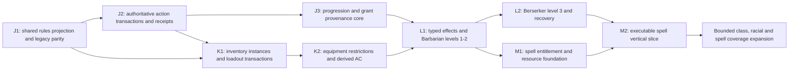

# Gameplay implementation roadmap — proposed after Checkpoint I

## Review contract and dependency order

This is a proposal, not an implementation authorization. It is grounded in [Checkpoint I's source audit](gameplay-architecture-checkpoint-i.md), baseline H `60bd800d89005c1af15db8a3925e2158e4644485`. I changes documentation only. G/H presentation and lifecycle are approved; use their screens and repositories. Do not start J until user review.

Recommended order:

M1 can be reviewed after L1 while L2 closes Frenzy/exhaustion/recovery; no need to finish every martial class first. If L2 grows, complete M's shared infrastructure before extending Barbarian beyond the approved slice. J3 establishes the advancement transaction early; each later class adds verified progression content through it. This is a refinement of the requested J/K/L/M sequence, not a wholesale new system.

**Common delivery gate for every implementation subcheckpoint:** separate branch from latest approved checkpoint; preserve G schema2/creationClosed and Tactical behavior; targeted regression tests plus full Java21 `build runGametest`; migration dry-run where relevant; exact counts, report and Minecraft checklist; stop for approval. Push only when that checkpoint authorizes it. Proposed files below are explicitly marked *new*; names are architectural suggestions, not existing capabilities.

## J — Character Rules Integration Foundation

### J1 — One rules projection with legacy parity

**Objective:** make the current SRD character read path a shared, explainable server projection before adding equipment/class mechanics.

**Prerequisites:** approve sectioned aggregate approach; obtain authorized SRD5.1 text/content manifest for new rule claims. I's official PDF requests returned403; existing source validation alone does not complete content verification.

**Likely modules:** existing `rules/srd/SrdCharacter.java`, `SrdCharacterCodec.java`, `SrdRules.java`; `character/CharacterRepository.srdInputs/srdSnapshot`; `CharacterSyncService.snapshot`; `uiapi/UiApiService`; `client/ui/DashboardModel`, `CharacterDashboardScreen`. *New*: `rules/srd/CharacterRules.java`, `DerivedRulesState.java`, `LegacySrdInputs.java`, `RulesProvenance.java`.

**Model:** typed aggregate references current inputs plus scoped identity, input/runtime/catalog stamps and compatibility mode. Preserve v1 formulas exactly. Derive AC/initiative/PB/speed/attack explanations; distinguish recorded level from effective combat level. Design a versioned mechanical input envelope with base-score/grant provenance, but do not automatically populate it from ambiguous names or final scores.

**API/permission:** capability and private derived-read projection; existing authentication/visibility and owner-versus-controller rules. Client cannot write derived AC/check/DC. Show legacy/manual mode honestly. Add coalesced authorized revision invalidations so a committed change refreshes the sheet; retain explicit Refresh fallback.

**Migration:** no forced conversion. Legacy adapter needs no data rewrite. A proposed opt-in conversion report shows current/proposed values, conflicts and provenance; changing mechanics still requires approval and later checkpoint support. No inferred racial ASIs.

**Automated tests:** parity for every existing codec fixture/armor/weapon, negative DEX, overrides, Tactical isolation; all revisions/cache invalidation; private versus DM projection; recorded-level mismatch; all six abilities; rejected unknown catalog/version; no privilege caching; sheet projection equals encounter inputs; preserve custom data/creationClosed.

**Minecraft cases:** reopen an approved bound character and compare sheet/encounter HP, AC, speed and initiative; edit a permitted unbound source and verify acknowledgement refresh; demonstrate recorded-level disagreement warning; unauthorized spectator receives no private data; verify G/H flows visually unchanged.

**Risks:** inadvertently replacing effective Tactical stats; changing current AC semantics; stale UI after asynchronous invalidation. Keep old adapters while parity tests fail.

**Acceptance:** all current automated outputs remain equivalent; one server projection supplies both relevant read paths; no UI-derived value is accepted as gameplay truth; a legacy record needs no migration to load/play. **Deferred:** loadout semantics, new race/class grants, spells, progression mutation.

### J2 — Extend accepted-action transactions safely

**Objective:** generalize the existing weapon action's atomic boundary for future loadout/resources/effects without introducing client-provided outcomes.

**Prerequisite:** J1 accepted; decide restart/receipt retention policy. Existing snapshot CAS and fixed-roll retry must remain intact.

**Likely modules:** `character/CharacterRepository`, `AtomicJsonFile`; `combat/SrdEncounter`, `SrdNetworking`, `SrdMovementTurn`; `core/TurnRequests`; `net/SrdRequestPayload`, `SrdStatePayload`; *new* `character/GameplayActionPlan.java`, `GameplayReceipt.java`, `combat/SrdActionBudget.java`.

**Model:** bounded typed candidate changes plus operation UUID/payload fingerprint/expected revisions. Persist PREPARED outcome/reservation and later COMMITTED receipt with all participant deltas in the campaign store. Build/runtime/manual revision domains remain explicit. Add SRD action/bonus-action/reaction/object-interaction budget representation with no unimplemented action exposed. A reaction window is a validated encounter event, not arbitrary out-of-turn spending. Define active-effect epoch dependency for future snapshots.

**API/permission:** reuse authenticated preview/confirm and DM exact retry. Same committed UUID returns an authorized existing result; different payload rejected. New requests cannot supply successful hit, roll, AC, final HP or resource delta. Only trusted validated plans reach the repository. Prepare/commit failure responses distinguish no commit from committed-but-reply-lost.

**Migration:** campaign schema5 candidate for receipts, with explicit readers for1–4. Keep library schema2 untouched. Test future-version refusal and coherent backup restoration. No two-file journal/character commit. Existing encounters are not silently resumed after restart; pending reservations are recovered for DM review, retaining fixed outcome, without replaying world movement.

**Automated tests:** fault injection before backup/temp/prepared replacement/final replacement and after commit before reply; both actors/stock/receipts atomic; same UUID same payload; mismatched UUID payload; stale turn/controller/approval; rejected action spends nothing; miss spends once; lost ACK/restart returns committed result; pending outcome survives restart without reroll; bounded receipt eviction cannot permit old replay; no spent-movement reset; event failure cannot roll back/re-spend committed resources.

**Minecraft cases:** ranged hit/miss and stock changes; DM simulated save failure/retry; disconnect after confirmation; read saved HP on reconnect; revoked controller rejected; manual counters remain inert.

**Risks:** introducing multi-step partial commits, request-history growth, publishing effects before disk, broadening retry permissions. The prepared state contains a reservation/outcome, not partially changed gameplay quantities. Do not call an action recovered unless persistence establishes it.

**Acceptance:** existing weapon behavior retained; generalized operation proves atomicity, replay protection and explicit restart semantics; budgets cannot be client-reset. **Deferred:** new class/spell/equipment actions, automatic encounter resume, distributed/multi-file world transactions.

### J3 — Progression and grant provenance core

**Objective:** establish the coherent level/choice pipeline needed by later levels1–3, keeping unknown/manual content intact.

**Prerequisites:** J1/J2; approve HP gain policy, advancement permission and legacy conversion workflow.

**Likely modules:** `uiapi/CreationRules`, `GuidedRaceRules`, `SheetSections`, `UiApiService`; both repositories; *new* `rules/srd/ClassProgression.java`, `CharacterGrants.java`, `character/AdvancementService.java`; minimal editor/confirmation using existing `RecordFormScreen`/`RpgConfirmationScreen`.

**Model:** source-qualified class levels, subclass/choice IDs, base scores versus adjustments, HP gain decisions, manual overrides and content version. Single-class only initially. Grant IDs stable by source/class level/choice; not duplicated on load or level-up. Build new mechanical inputs atomically; recorded progression becomes a projection for converted records. Current HP delta is explicit; no automatic full healing.

**API/permission:** `ADVANCEMENT_PREVIEW` and `ADVANCEMENT_COMMIT`, expected revisions and operation identity. Owner proposes; manager/campaign policy authorizes; no advancement in an active encounter. Library completion still differs from campaign approval; closed creation reset remains forbidden. Unimplemented required choices block mechanical-readiness, not deletion of historical records.

**Migration:** reviewed conversion only, outside encounters and initially unbound; legacy levels/scores/grants shown before/after. Do not silently set `srd_combat.level` from UI level. Preserve manual/custom proficiency strings and original grant sources.

**Automated tests:** proper subclass gates1/2/3; level2→3 exact once; failed save no partial level/HP/spell grant; no client HP reroll; PB correct boundaries; score bonuses not double-applied; all12 class metadata gates; creationClosed/history; owner/controller/DM policies and reapproval.

**Minecraft cases:** preview a level-up, cancel, submit incomplete choices, then complete; compare old/new HP and level; verify pending approval and independent library/campaign copies.

**Risks:** presenting a progression schema as implemented feature coverage. **Acceptance:** a validated transactional pipeline with explicit unsupported-content gates and a tested small fixture progression; no class advertised fully playable until its later feature checkpoint passes. **Deferred:** multiclass, level4+ ASI/feats, automatic XP awards, full twelve-class content.

## K — Equipment and Armor Class Integration

### K1 — Inventory identity and loadout transactions

**Objective:** owned item instances and valid slot references; remove the whole-stack equip ambiguity.

**Prerequisites:** J1/J2; item identity/stack/alias and acquisition permissions approved. Use J3 conversion/provenance conventions where applicable.

**Likely modules:** `SheetSections.Item/Inventory`, `LibraryRepository`, `CharacterRepository`, `UiApiService`; `InventoryModel`, `InventoryForms`, `InventoryDetails`, `InventoryWorkspace`, `CatalogAddScreen`; *new* `rules/srd/EquipmentCatalog.java`, `EquipmentLoadout.java`, `character/EquipmentService.java`.

**Model:** versioned inventory/loadout, existing scoped IDs retained; known definition aliases mapped explicitly; instances quantity1; stack metadata/fingerprint; armor/main/off/shield/ammunition references; shield/off-hand occupancy represented once. Split and merge in the same candidate state. No server rules inferred from row names/properties/Minecraft mapping notes.

**API/permission:** typed preview/commit equip, unequip, split, merge; owner library operations versus approved campaign controller play; manager-only or campaign-authorized acquisitions/transfers; expected revision/operation UUID. Campaign transfers check both records and commit once; omit transfer UI until this path is implemented. Initially reject live combat equipment changes with explanation.

**Migration:** inventory section version upgrade plus loadout section; preserve original equipped flags as historical intent pending review. Ambiguous stack/slot/custom definition remains unresolved/manual, not silently equipped. Capacity check before split. No resource conversion yet if ammunition authority is unresolved.

**Automated tests:** five-dagger conservation; two distinct hands; zero/negative/overflow rejection; max-row split; dangling/cross-character ID rejection; shield/off-hand exclusivity; two-hand grip conflict; unique item never merged; metadata-sensitive merges; removal of equipped item cannot dangle; transfer atomicity if exposed; retry after split/merge cannot duplicate IDs; names unchanged across independent copies.

**Minecraft cases:** equip one of five daggers, then another; inspect remaining stack3; unequip/merge; same-name customized dagger stays separate; stale two-client operation; custom item remains manual with clear explanation; failed save leaves quantities unchanged.

**Risks:** copied IDs mistaken for global IDs; implicit deletion of references; treating custom notes as mechanical data. **Acceptance:** persisted loadout is structurally valid and transactionally owned; projected equipped labels reflect it; existing inventory text/currency preserved. **Deferred:** live equip action costs, derived AC switch, automatic ammo conversion, magic/attunement, physical Minecraft mapping.

### K2 — Equipment rules, ammunition and shared AC

**Objective:** valid loadout changes affect the shared derived state and actual encounter outcomes without manual AC edits.

**Prerequisites:** K1/J3 and J2 action budgets; source-verified complete mundane SRD armor definitions; approved current-v1 equipment/stock conflict resolution.

**Likely modules:** `SrdEquipment`, `SrdCharacterCodec`, `CharacterRules` (new J1), `SrdRules`, `SrdEncounter`, `SrdMovementTurn`, `EquipmentService`, `CharacterRepository.commitSrdAction` adapter and dashboard inventory projection.

**Model:** authoritative typed armor/hand/grip/ammo-source inputs; complete mundane armor catalog; proficiency/Strength/stealth properties; legacy typed overrides isolated. Ammo comes from one mapped inventory source after conversion, never both stack and virtual counter. Item attacks carry instance ID, definition and grip rather than trusting catalog membership alone.

**API/permission:** server computes eligibility/cost. Outside encounter: validated equip/don/doff workflow with completion timing/adjudication explicitly represented. In encounter: supported draw/stow/grip/shield actions via turn/intent/budget; reject long-duration armor changes until timed operations exist. Do not allow bound raw section edits as a workaround. Reapproval is for changing approved build/authorized item mechanics; normal validated loadout use should not require unbinding every turn.

**Migration:** explicit selected inventory versus legacy armor/weapon/ammo reconciliation. Preserve a legacy compatibility mode until DM acceptance; no quantity guessing. Retain existing AC/attack/damage bonuses as clearly labeled overrides until adjudicated.

**Automated tests:** every AC case in audit §5; all mundane armor formulas including negative DEX; shield don/doff one action; two-handed/versatile use; off-hand availability; armor nonproficiency and spell restriction flag; heavy Strength speed and verified dwarf exception; throw spends exact instance on hit/miss; ranged source depletion once; action/resource atomic fault tests; mid-turn speed recompute preserves spent feet and invalidates old path/preview; expired effects invalidation hooks.

**Minecraft cases:** Fighter DEX14 studded leather AC14→shield16→shield removed14; greatsword grip conflict; heavy armor speed penalty; nonproficient warning/consequence; inventory ammo consumed on a miss; repeated preview cannot spend; active-turn swap cost and out-of-turn rejection; sheet/target AC agreement.

**Risks:** movement budget resetting; permanent bonus stacking; old ammo staying spendable; applying nonproficiency as equip prohibition instead of rule consequence. **Acceptance:** supported armor/equipment values come from owned loadout, same server calculation reaches sheet and engine, no manual AC editing needed. Class alternative bases can be represented and tested but only granted with verified entitlements. **Deferred:** magical catalog, attunement, dual-wield combat feature details beyond supported basic rules, live multi-minute armor operations, encumbrance and physical item synchronization.

## L — Class Feature Foundation

### L1 — Typed effects, checks and Barbarian levels1–2

**Objective:** one real class vertical slice demonstrates features/resources/actions/defenses without encoding feature names as bonuses.

**Prerequisites:** J1–J3/K2; authoritative check/save path, hostile/ally targeting policy, bonus-action budget and duration clock decisions. Verify exact SRD feature text before executable data.

**Likely modules:** `CharacterGrants`, `ClassProgression`, `CharacterRules`, `SrdRules/SrdHealth`, `SrdEncounter/SrdNetworking`, shared action plan; *new* `rules/srd/FeatureEffects.java`, `EffectInstance.java`, `BarbarianFeatures.java`, `combat/SrdChecks.java`; capability-driven existing Features/HUD controls.

**Model:** grant identity versus active effect instance; typed predicate/modifier/defense hooks; Rage current/max/recovery; turn-relative expiry and activity evidence; condition tags; persistent source/receipt. Ordinary manual `ui_features` remain inert. AC uses alternative-base selection. Status progression survives save/reconnect without refreshing uses.

**API/permission:** activate/end Rage and choose Reckless through server intents; check/save requests select approved ability/skill and context rather than provide total. Server revalidates current actor/controller, resource/action/condition restrictions. Dangerous hidden target details stay server-only.

**Migration:** opt-in class grants, no matching “Rage” manual pool by name; preserve manual pools separately and resolve duplicate-resource conflicts with DM. Added active effect/resource version refuses older gameplay readers.

**Automated tests:** Rage2 uses at levels1/2 and no fourth invisible counter; bonus-action spend; heavy-armor benefit suppression; STR melee damage only, thrown/DEX exclusion; resistance once with rounding; timeout/activity/unconsciousness/voluntary end; casting/concentration block; Reckless first-attack timing and opponent advantage expiry; Danger Sense seen/unseen and blinded/deafened/incapacitated exclusions; Unarmored Defense armor/shield cases; rejected activation no spend; retry/restart exact once; save effects don't mutate legacy manual trackers.

**Minecraft cases:** activate Rage, compare STR/DEX attacks and damage received; inspect use count after disconnect/reconnect; toggle armor to observe eligibility; choose Reckless and test opponent turn; execute DM-controlled visible DEX save; compare shared AC.

**Risks:** all-participant-hostile assumption, blanket damage/save advantage, effect ticking twice, stale effect caches. **Acceptance:** level1–2 Barbarian supported rules demonstrably affect attacks/HP/AC/saves and display same authoritative breakdown. **Deferred:** Frenzy/level3 claim, all other class feature content, full condition catalog and general spell engine.

### L2 — Berserker level3, exhaustion and real recovery

**Objective:** complete the bounded Barbarian1–3 vertical slice through the same progression/effect path.

**Prerequisites:** L1; J3 subclass choices; source-verified 2014 exhaustion and rest rules. A manual exhaustion marker or approved rest request does not satisfy them.

**Likely modules:** `BarbarianFeatures`, `ClassProgression`, `FeatureEffects`, `SrdActionBudget`; `UiWorkflowStore`, `UiNetworking`, `RpgRecords` separation; *new* `character/RestRecoveryService.java`, `rules/srd/ExhaustionRules.java`.

**Model:** Berserker grant at3, Rage3 uses, explicit Frenzy chosen with activation, bonus attack availability starting subsequent turns, once-only exhaustion-on-end receipt. Completed rest state includes timing/interruption/resource-recovery receipt. Track automated exhaustion separately from legacy manual marker until conversion resolves it.

**API/permission:** level3 choice preview/commit; Frenzy attack spends correct bonus action; manager-approved rest start/completion with elapsed/interrupt validation, no “approve means replenish.” Decide safe defeat/death policy before exhaustion6; retain DM adjudication boundary rather than silently causing vanilla death.

**Migration:** preserve historical manual exhaustion/Hit Dice/pools and reconcile explicitly; do not consume old rest approvals. No silent refilling of Rage when adding its max.

**Automated tests:** level3 subclass gate, Frenzy activation-turn rejection, one bonus attack, Rage end twice/restart yields one exhaustion increase, exhaustion penalties/recovery, long-rest uses reset once, interrupted/ineligible rest no recovery, concurrent manual/automated changes isolated, storage failure cannot refill twice.

**Minecraft cases:** advance2→3, choose Berserker, use Frenzy across turns, end and verify exhaustion consequences; approve then interrupt a rest; complete a valid rest and verify exact recovered resources.

**Risks:** expanding recovery into a full survival simulation; unsupported defeat handling. **Acceptance:** Barbarian1–3 declared complete only for the explicitly tested encounter/rest scope with no inert feature masquerading as automated. **Deferred:** Barbarian4+, non-SRD paths, other classes; broader exploration/death semantics require separate review.

## M — Spellcasting Foundation

### M1 — Entitlements, verified definitions and resource pools

**Objective:** distinguish a listed spell from a legal, prepared/known, resourced casting option before exposing executable Cast.

**Prerequisites:** J3 and L1 typed effects; obtain source-verified SRD5.1 content and retain attribution. M1 must not wait for all twelve classes. Coordinate recovery with L2 rather than building a second rest service.

**Likely modules:** `SheetSections.Spellbook/SpellDefinition/SpellSelection`, `RpgRecords.catalog`, `UiApiService`, `ClassProgression/CharacterGrants`, `CharacterSyncService`, `SpellReference`, existing Spells panel; *new* `rules/srd/SpellCatalog.java`, `SpellcastingRules.java`, `SpellEntitlements.java`; versioned data under a new server-readable SRD catalog resource path.

**Model:** immutable standard catalog IDs/version/attribution and separate custom manual definitions; class source, book/known/prepared/always-prepared selections; class-specific cantrip/known/prepared limits; standard slots versus pact slots and source-specific limited casts. Derived DC and attack from ability/PB. Add verified class progression tables for caster1–3; capability says whether each spell has an executable handler.

**API/permission:** validated learn/prepare operations, rest/level gating and revisions; server verifies class-list eligibility and selection capacity. Preserve old custom-only spellbook parser through a versioned adapter; do not suddenly accept any client-named standard spell. Automated slots are not writable by `MANUAL_COUNTER`.

**Migration:** custom entries remain custom; never convert by display name. Manual slot maxima/current values retained as legacy annotations until explicit conversion. Establish initial current pools by reviewed conversion, not automatically full. Known/prepared historical claims require adjudication. Spell targeting requirements must come from each verified definition; Bless does not impose a willing-target requirement.

**Automated tests:** full-caster1–3 slot schedule; Paladin/Ranger start2; pact slots and recovery; Wizard spellbook versus preparation; Cleric/Druid preparation, domain always-prepared capacity; learned-spell limits; unverified/non-SRD ID rejection; no manual pool overwrite; racial versus class casting ability; derived DC equality; malformed/versioned content rejection.

**Minecraft cases:** compare known/unprepared/prepared/always-prepared/unsupported spells; select lawful versus unlawful options; inspect slot and DC projection; check custom spell descriptions remain accessible without enabled Cast.

**Risks:** implying catalog import equals automation; treating pact as normal slots; widening content scope. **Acceptance:** legal entitlement/resources are server-derived and truthful, with no false Cast affordance. **Deferred:** spell execution (M2), full spell corpus, metamagic, summons, ritual timing and costly component consumption until explicit supporting slice.

### M2 — Minimal executable spell slice

**Objective:** execute Fire Bolt, Sacred Flame, Cure Wounds and Bless through existing authoritative intents and expanded transactions.

**Prerequisites:** M1, L effects/save/action/recovery foundations, friendly target support and per-spell target constraints and audited component/LOS rules. Existing controlled free-for-all cannot blindly reject ally healing or infer spell target restrictions.

**Likely modules:** `SrdEncounter`, `SrdNetworking`, shared `GameplayActionPlan`, `SrdChecks`, `SrdTargeting`, `SrdHealth`, `CharacterRules`; *new* `rules/srd/SpellEffects.java`, `combat/SpellCastingService.java`, `ConcentrationState.java`; existing Spells panel/HUD action selection.

**Model:** cast intent bound to class source/slot/targets/component plan; source-linked timed effects and one concentration record per caster; atomic participant resource/HP/effect changes; deterministic saved outcomes. Catalogue metadata selects reviewed handlers, never executes free text.

**API/permission:** preview/confirm with server caster authority, phase, spell eligibility, action availability, hands/focus/material validation and targets. No success/damage/DC supplied by client. Concentration replacement requires explicit reviewed choice. Revalidate geometry/targets immediately before acceptance.

**Migration:** no conversion of manual spell descriptions into effects. Version new active-effect/resource sections; restart preserves committed concentration/effects or explicitly suspends them for adjudication according to approved policy. Never resurrect an expired effect on reload.

**Automated tests:** spell attack hit/miss/critical; Sacred Flame DEX save and cover exception; touch/healing restrictions; slot debit on accepted cast including failed target save outcome; failed validation no cost; no duplicate heal; Bless1d4 once per eligible attack/save and correct number of targets/upcasting; concentration damage save with temp HP, multiple sources, incapacitation, replacement, expiry; atomic multi-target persistence and lost ACK; old manual slots unchanged; privacy; no SRD effect writes Minecraft physical health unintentionally.

**Minecraft cases:** cast each spell at valid and invalid targets/ranges; consume last slot and reject next cast; Bless multiple party members, observe rolls, take damage and lose concentration; replace Bless, reconnect, expire; simulate failed save and exact retry; view same HP/pools/effect state on sheet and encounter.

**Risks:** target willingness/faction ambiguity, damage-order mistakes, concentration effects left on remote targets, component shortcuts. **Acceptance:** the four named spells run end-to-end with correct costs/effects and defined restrictions; unsupported spells remain clearly unavailable. **Deferred:** complete class spell lists, reaction spells, area/summon/control breadth, rituals/metamagic. A caster with four supported spells is a tested foundation, not a fully implemented caster class.

## Later checkpoints — close coverage deliberately

Do not combine these into one “all classes” implementation. Each row is an independent reviewed checkpoint (or several if needed), inheriting the common build, permissions, migration and reporting gates.

| Checkpoint / objective | Prerequisites and likely modules | Data/API/migration | Required tests and Minecraft acceptance | Risks / explicitly deferred |
| --- | --- | --- | --- | --- |
| N1 — Fighter1–3, then Rogue1–3 in a separate review | K2/L/M action foundations; `SrdRules`, `ClassProgression`, typed `FighterFeatures` / `RogueFeatures` (new), targeting/action budget | Source grants; Second Wind/Action Surge pools; style selection; Sneak Attack per-turn history; typed action/decision verbs; explicit legacy grants reconciliation | Automated style predicates, extra action not full turn, critical19, Sneak Attack eligibility/once-per-turn, reaction-turn interactions, Cunning Action/Fast Hands/Second-Story Work; manual complete progression and real actions for each class | Do not share Tactical budget semantics blindly. Defer non-SRD archetypes, levels4+, unsupported action named as “implemented.” |
| N2 — Reactions, basic conditions and racial combat grants | L/M2; `SrdActionBudget`, `SrdChecks`, `SrdTargeting`, effect handlers, reaction request payload | Server-owned pending reaction windows, expiry and choice receipt; source-qualified race traits; APIs select eligible reaction, not arbitrary outcome; opt-in racial ASI/speed/size migration | Replay/timeout/disconnect/out-of-order reactions; Shield timing, Hellish Rebuke, poison/frightened/magic-save predicates, half-orc endurance/critical die, dragonborn breath, racial spell limits; manual two-player reaction sequence and saved uses | Needs attack result timing before final commit. Defer broad vision/light mechanics to N3; do not claim full races yet. |
| N3 — Racial exploration/vision and rest exceptions | N2 + movement/visibility design; `SrdTerrain`, `SrdTargeting`, `CharacterRules`, rest service | Explicit D&D light/vision/size/language/tool grants; no Minecraft material/name guesses; DM override for unsupported scenes; no destructive custom-data rewrite | Darkvision range/light restrictions, Elf Trance approved rest interpretation, Halfling movement/stealth, gnome magic saves, dwarf exceptions; manual light/cover/party rest cases | Vanilla invisibility/night vision is insufficient. Defer unsupported custom species, 2024 rules; require exact SRD interpretation review for rest language. |
| N4 — Monk1–3, then Paladin1–3 separately | K/L/M/N2; new class handlers, attack-hit decisions, component/grip/resource state | Ki/LoH/Divine Sense/Channel Divinity pools; Monk weapon/armor grants; Smite slot decision after confirmed hit; Devotion choice; versioned grants/pools | Monk AC/Martial Arts/Flurry/Ki movement/Deflect Missiles/Open Hand; Paladin sense/pool healing/Smite/Oath/Divine Health; save failures and replays; manual full1–3 progression with real actions | Jump/disengage/dodge/conditions and reaction returns need real support. Defer other traditions/oaths; spell subset still bounded. |
| N5 — Ranger1–3 and remaining martial/exploration actions | N1/N2/M, exploration decision design; `ClassProgression`, targeting/skills, new `RangerFeatures` | Hunter choice and per-turn/reaction predicates; Primeval Awareness slot use; favored-enemy/terrain source grants, approved manual adjudication for unsupported world questions | All three Hunter options, once-per-turn handling, spell schedule, knowledge/travel checks; manual chosen option and resource use; declare any manual exploration affordance | Do not conflate “nearest Minecraft mob” with favored enemy or creature-type sensing. Defer non-SRD subclasses and broad travel simulation. |
| N6 — Bard/Lore, Cleric/Life, Wizard/Evocation (one class per review) | M2/N2 and further verified spells; handlers plus catalog and recovery | Inspiration/Cutting Words, Channel Divinity/Life healing, spellbook/recovery/Sculpt Spells; source-qualified pools/choices and validated APIs, preserve custom notes | Each class's level matrix, lawful spells, reaction/healing/turn-undead/area exceptions and rest recovery; manual complete class scenario; no pool reset via preparation | Turn Undead and Sculpt Spells need executable conditions/AOE, not descriptions. Defer other subclasses; incomplete spell options explicitly reported. |
| N7 — Sorcerer/Draconic and Warlock/Fiend separately | M/N2, spell modifier and summon/pact design | Sorcery Points/slot conversion receipts; metamagic legality/cost; pact slots/invocation prerequisites/boon entities; temporary HP source; explicit class handlers | Conversion conservation, metamagic per-spell restrictions, Draconic AC/HP, Fiend tempHP, pact recovery, Blade/Chain/Tome grants; manual each chosen boon/metamagic | Familiar/Chain requires controlled summon lifecycle; not a free NPC spawn. Defer other origins/patrons; support all authorized choices before full-class claim. |
| N8 — Druid/Land and Wild Shape | M/N2/N3, form/HP transition design; new `WildShapeRules` + approved beast catalog, encounter entity adapter | Distinct form stat projection, form HP pool/excess-damage return, retained grants/concentration, duration and uses; source-owned entities; explicit transition transaction | All level2/3 beast CR/movement limits, HP carryover, voluntary/end/zero reversion, no duped entity/control, concentration across shape, Circle spells/Natural Recovery; manual transformation/reload/death boundary | Largest class-specific risk; split form storage and gameplay into reviews. Defer non-SRD circles and unrestricted monster forms. |
| N9 — Spell coverage and class readiness closure | M through relevant N class slices; verified SRD0–2 spell/class list manifests plus racial grants | Import additional standard definitions with reviewed behavior IDs; per-spell capability; richer targeting/durations/conditions; no client formulas | Automated manifest coverage and every supported spell's costs/targets/exception/retry; manual representatives of attack/save/heal/buff/control/AOE/reaction/ritual; all12 level1–3 classes have no required dead feature | Avoid claiming all spell choices functional when only sample subset runs. Higher-level spells, proprietary content, full monster automation deferred. |
| N10 — Level4+ feats/advancement and future multiclass | Completed1–3 acceptance and user approval; existing J3 grants/progression | ASI/feat substitution, prerequisites, Grappler when grapple system exists; optional multiclass class-level list and shared slot rules in later separate checkpoint | No double grants/PB, ASI caps, source-specific proficiency/HP/slot changes; manual advancement/cancel/reapproval | No large feat catalog in initial target, no variant-human assumption, no multiclass mixed rules without separate authorization. |

For each expansion, a feature that remains manual must be labeled as such and excluded from “mechanically complete” acceptance. Content coverage is a manifest mapping every authorized class level1/2/3 feature/choice to implemented handler + tests or explicit missing status. A single successful Barbarian/Fighter encounter is not twelve-class acceptance.

## Ten worked scenarios in the proposed architecture

These are future processing contracts. None were implemented or gameplay-tested during I. They show validation, calculation, persistence and UI responsibilities using the existing repositories as the base.

### 1. Fighter equips studded leather and a shield

**Validate:** actor owns mapped item instances; approved Fighter armor/shield grants exist; outside combat or supported don/doff completion; expected revisions match. Shield occupies off hand and conflicts with a second held item. Character scope is campaign or personal explicitly.

**Calculate:** DEX14 gives studded12+2=14; shield+2=16. If the character actually chose Defense, +1 while armored gives17; do not infer it from “Fighter.” Return proficiency/Strength/hand and timing explanation.

**Persist:** one loadout transaction, item references and operation receipt; derive on read rather than persisting another AC field. No change before donning completes. For legacy conflicts, require reviewed conversion first.

**UI:** request slot change, show pending timing/cost, then ACK and shared AC breakdown. The encounter obtains the same state; no “edit AC to16” instruction.

### 2. Fighter changes to a two-handed weapon

**Validate:** same owned weapon instance, current grip, shield/off-hand occupancy and available action/interaction. Holding a greatsword one-handed is not permission to attack two-handed. Doff shield as an action when in combat; draw/stow obey supported interaction rules. A combined plan must explicitly include each cost and reject if insufficient.

**Calculate:** shield removal reduces AC16→14 in the previous example (Defense would retain its +1); legal greatsword attack uses two hands and verified proficiency/ability/dice. Weapon alone does not add AC.

**Persist:** valid staged operation is atomic; no shield removed while weapon split fails. Any required sequential turn actions each have their own visible accepted state/receipt. Invalidate old attack intent and reconcile movement if loadout changed speed.

**UI:** explain blocked hands or required action; show final held items/AC only after acknowledgement.

### 3. Rogue equips one dagger from a stack of five

**Validate:** ordinary stack A quantity5, valid dagger definition, hand free, split capacity, permission/revision. No conversion of a custom named “dagger” by name.

**Calculate:** A4 plus instanceB1 in main hand; total5. Second equip creates C1 and leaves A3. No Sneak Attack bonus is awarded simply for selecting Rogue; that requires its later handler/context.

**Persist:** one split/loadout transaction with server-assigned stable B; retry returns B, not another split. Throw consumes B plus target effect atomically; merge only unequipped compatible metadata and retire merged ID.

**UI:** distinguish stack4 and equipped instance1; do not paint the full five-stack as equipped. Lost ACK triggers receipt reconciliation, not a second add.

### 4. Barbarian activates Rage and receives damage

**Validate:** class level/grant, available Rage, bonus action, turn/controller and conditions; evaluate heavy armor benefits separately. Revalidate attack/damage context.

**Calculate:** spend one use; create Rage effect/duration/activity state. Eligible incoming slashing damage9 becomes4 through one resistance application before tempHP/current HP absorption; duplicate resistance sources do not quarter it. Eligible STR melee damage gains+2, DEX/thrown does not.

**Persist:** activation resource/effect/bonus reservation commits together. Damage commits target HP, affected activity flags/concentration state and receipt together. End/restart cannot refund a use. Frenzy ending has its own once-only exhaustion consequence.

**UI:** show active Rage, remaining uses, remaining duration/termination reason and damage breakdown visible to authorized recipients; no permanent resistance added to race data.

### 5. Monk uses Unarmored Defense

**Validate:** verified Monk grant, no worn armor/shield, actual DEX/WIS and effect overrides. Independent formula selection prevents summing a Barbarian/Monk/Mage Armor base.

**Calculate:** DEX14 WIS16 →15. Equipping shield invalidates Monk base; ordinary unarmored12+shield2→14, with nonproficiency consequences if no shield grant. Future valid alternative bases are selectable, not additive.

**Persist:** only grant/input/loadout/explicit choice changes. Cache invalidation recomputes AC; never save “Monk bonus+3” as an unqualified permanent override.

**UI:** show which formula is active and why Monk formula became ineligible. Encounter defense uses the same result.

### 6. Spellcaster casts a slotted concentration spell

**Validate:** Bless learned/prepared/always-prepared through a legal source, supported handler, slot, action, components/focus/free-hand requirements, spell-eligible selected targets/range, existing concentration replacement choice and current revisions. Reject without cost when invalid.

**Calculate:** server chooses effect targets and duration; slot level controls supported target count. One concentration source links all target buffs. Later damage produces server CON save with DC max10/half damage, accounting for damage after defenses and including temporary-HP absorption as damage taken.

**Persist:** slot, action, concentration replacement and all target effects atomically; outcome/receipt retained for retries. Loss/expiry removes linked effects atomically and invalidates relevant views. No manual slot counter is debited too.

**UI:** show selected spell/slot/targets/cost before confirm; update pool/effects on ACK; hide unauthorized target details. Listed custom spells remain inspectable but cannot call this handler.

### 7. Level2 character advances to3 and chooses a subclass

**Validate:** example Fighter2→3: authorized milestone/XP, out of encounter, current build revision, no prior conflicting choice; Champion is available SRD archetype. A Wizard already selected Evocation at2, so the same transaction must not ask every class to choose at3.

**Calculate:** retained fixed/rolled HP choice plus CON, Champion grant/critical threshold, resources and PB (still+2). For appropriate casters, spell entitlements/slots also change. Preserve prior manual grants and explicitly adjudicate conflicts.

**Persist:** all choices, HP maximum/current adjustment policy, grants, level and approval transition in one advancement commit. Failure leaves level2 unchanged; replay does not grant HP twice.

**UI:** before/after summary and missing-choice validation; relevant subclass controls only; show reapproval requirements. Library edits do not overwrite an approved campaign copy.

### 8. Character is approved and bound to a player entity

**Validate:** campaign DM authority, owner/controller membership, supported mechanical-ready record, target player's controller identity, one-to-one binding, no active encounter on target. Approval and binding remain separate; selection alone is not binding.

**Calculate:** derive full supported state and detect unresolved conversion/grants before admission. Compare campaign/rules profile; do not take vanilla health/armor as SRD inputs.

**Persist:** existing approval/binding transactions with revisions and policy; no copy of mutable client state. Bindings remain entity UUID→campaign character ID. Apply SRD projection through its adapter, preserving Tactical's separate vanilla health behavior.

**UI:** clearly show approved, selected and bound states; private sheet/encounter read models for controller/DM. Encounter start still performs loaded actor/geometry/client capability checks.

### 9. Equipment change during an active encounter

**Validate:** exact encounter/turn/actor/item/operation identity, control, no unresolved transaction, supported change/cost. Out-of-turn change or multi-minute armor change rejected in initial K. Shield don/doff requires available action; draw/stow uses supported interaction budget. No raw-section bypass while bound.

**Calculate:** derived consequences before committing, including speed/size/AC/casting restriction. Preserve feet already spent; recompute remaining allowance under explicit speed-change policy, never reset spent feet. Invalidate pending attacks/routes based on old loadout.

**Persist:** equipment plus action budget/resource/effect changes through accepted transaction; rebuild committed encounter projection after success. Prevalidate movement reconciliation so it cannot unexpectedly fail after disk commit.

**UI:** explain legality/cost/rejection; accepted ACK updates sheet and encounter. Physical Minecraft inventory remains independently gated.

### 10. Save fails during a resource-changing action

**Validate:** initial request accepted only after server legality/snapshot checks. Once prepared, retain operation ID, expected state and fixed rolls; no new revision rebase on retry.

**Calculate:** immutable candidate includes all participants' HP/items/pools/effects and resulting projection. Do not publish candidate changes before persistence.

**Persist:** if initial preparation fails, publish no success/effect. If final write fails after durable PREPARED, prior gameplay quantities remain and reservation/outcome survive; retry same plan. Atomic replacement applies all deltas and COMMITTED receipt together. Crash after commit before ACK returns stored result. Post-commit presentation failure must refetch, not re-spend. Unsupported filesystem failure/backup rollback invokes explicit adjudication, not exactly-once guarantees that storage cannot provide.

**UI:** pending or save-failed status and DM recovery guidance; no success animation/HP update until committed. Client cannot “retry” by generating a new UUID to bypass reservation. Existing H provides only in-memory retained rolls/CAS; durable prepared outcomes are J2 work.

## Review decisions and first implementation recommendation

Start with **J1: shared authoritative rules projection and legacy parity**. It is small enough to validate without touching every class, and it exposes rather than hides current disagreements. Review J2's durability design before widening combat mutations. Keep K1 and K2 separate so inventory identity is proven before AC/action integration.

Before J implementation, approve: typed aggregate/adapters; opt-in migration and DM conflict resolution; rules-content source manifest; durability/restart/effect-clock policy; AC alternative selection default; level-up HP policy; campaign permissions for inventory acquisition and progression. These choices are specified in audit §11. No decision here authorizes broad gameplay changes in I.

Final overall1–3 acceptance requires every authorized feature/choice in the audit's twelve-class matrix either mechanically supported with tests or honestly excluded from the release claim; same authoritative state on sheet/encounter; inventory/HP/pools conserved through failures/retries; correct subclass levels and spell/recovery behavior; existing permissions and data preserved. Full functionality cannot be declared from UI labels or a single vertical slice.

I baseline was actually run: **7,216 assertions / 30 suites and 120 GameTests, no failures**. Those validate the existing code only. All new tests and Minecraft scenarios in this roadmap are **requirements for future checkpoints**, not completed tests. No gameplay implementation, asset change, dependency change or data migration occurred in I. Stop for user review.
